## Capítulo 1. Introducción, problema, justificación, objetivos y alcance

### 1.1 Introducción

SmartRoad AI es un proyecto académico desarrollado en la asignatura Electiva Ciencias de la Computación II de la Universidad Surcolombiana, orientado al diseño y evaluación de detectores de objetos aplicados a la seguridad vial. Su motivación inicial surge de la necesidad de identificar, de manera automática, situaciones de riesgo en el tránsito —particularmente accidentes y la presencia de fuego—, con el fin de apoyar procesos de monitoreo y respuesta de emergencia. A partir de esa idea, el proyecto evolucionó hacia un estudio experimental comparativo en el que se entrenan y evalúan cuatro arquitecturas de detección: **YOLOv8n**, **YOLOv10n**, **YOLO11n** y **RT-DETR-L**.

El objeto de estudio son imágenes de escenarios viales anotadas con seis clases: **Accidente**, **Bus**, **Camion**, **Carro**, **Fire** y **Moto**. Cada clase plantea un reto diferente para un detector. Los vehículos presentan tamaños y orientaciones variables; los accidentes carecen de una forma estándar y dependen fuertemente del contexto; el fuego compite con reflejos, sombras y zonas de alto contraste cromático. Esta heterogeneidad convierte al problema en un caso de estudio útil para contrastar arquitecturas, ya que no es evidente cuál de ellas responderá mejor ante cada tipo de instancia.

El proyecto se distingue de una implementación comercial por su carácter experimental y documental. No se trata solo de obtener el detector con la mayor métrica global, sino de comprender por qué ciertas arquitecturas funcionan mejor en determinadas clases, cómo se comportan ante un dataset con desbalance de categorías y qué posibilidades ofrecen sus predicciones para una futura integración. Todos los artefactos generados —scripts, configuraciones, resultados de entrenamiento, curvas, matrices de confusión y pesos— se conservan en el repositorio como evidencia académica, de modo que el proceso pueda auditarse y reproducirse.

### 1.2 Planteamiento del problema

El problema central de SmartRoad AI puede enunciarse como sigue: *dada una imagen de un escenario vial, localizar y clasificar instancias de las seis clases definidas con la mayor precisión y robustez posible*. Resolver este problema exige más que seleccionar un modelo de detección de objetos y ajustarlo. Es necesario comprender cómo distintas arquitecturas aprenden representaciones diferentes de los datos, cómo reaccionan ante clases minoritarias o visualmente ambiguas, y si sus errores son lo suficientemente complementarios como para justificar un sistema combinado.

A partir de este problema se deriva la siguiente **pregunta de investigación**:

> *¿Cuál de las arquitecturas YOLOv8n, YOLOv10n, YOLO11n y RT-DETR-L ofrece el mejor comportamiento en la detección de cada una de las seis clases del dataset SmartRoad AI, y bajo qué condiciones sus predicciones podrían resultar complementarias para un sistema multimodelo?*

La pregunta contiene dos componentes. El primero es comparativo: se busca establecer un ranking empírico de desempeño por clase y global. El segundo es exploratorio: se indaga si la combinación de predicciones aporta ventajas respecto a los modelos individuales. Este segundo componente no asume que la integración sea beneficiosa; su utilidad debe demostrarse con evidencia, no postularse como consecuencia natural de usar varios modelos.

Una dificultad adicional reside en la trazabilidad del dataset. Si bien todos los modelos comparten la misma definición de clases, los archivos `args.yaml` registran rutas de datos distintas: YOLOv10 y RT-DETR-L apuntan al `dataset/data.yaml` local, YOLOv8 conserva una ruta absoluta de otra máquina, y YOLO11 (entrenamiento definitivo) apunta a un archivo en Google Colab. Esto impide afirmar, sin verificación adicional, que los cuatro entrenamientos consumieron exactamente la misma versión binaria del dataset. Por tanto, la comparación entre modelos debe presentarse con la debida cautela metodológica.

### 1.3 Justificación

La detección automática de accidentes y situaciones de riesgo en el tránsito tiene una relevancia social directa: reducir el tiempo de respuesta de servicios de emergencia o priorizar la atención de zonas críticas puede incidir en la gravedad de las consecuencias. Desde una perspectiva académica, SmartRoad AI justifica su desarrollo porque confronta cuatro arquitecturas representativas del estado actual de la detección de objetos con un dataset específico, en lugar de reproducir resultados genéricos de benchmarks públicos. Esta decisión metodológica permite observar cómo se comportan los modelos cuando el dominio, el balance de clases y las condiciones de anotación difieren de los escenarios estándar.

El análisis por clase es particularmente importante. Clases como *Accidente* y *Fire* tienen un alto costo de error si se clasifican incorrectamente o se omiten, pero suelen estar menos representadas que *Carro* o *Moto*. Una métrica global, como el mAP promedio, puede ocultar un mal desempeño en estas categorías críticas. Por ello, el proyecto prioriza la evaluación desagregada mediante matrices de confusión, curvas de precisión-recall y métricas de mAP por clase, además de predicciones visuales sobre subconjuntos específicos, como imágenes con presencia de fuego.

Finalmente, el estudio de una posible integración multimodelo responde a una pregunta técnica legítima: si las arquitecturas cometen errores distintos, una combinación cuidadosamente diseñada podría compensar debilidades individuales. Esa posibilidad no se asumió como cierta: la formulación matemática del acoplamiento delimita bajo qué supuestos una fusión de predicciones tiene sentido, y su implementación en la aplicación se validó sobre el split TEST frente a cada modelo individual (sección 7.9). De este modo, SmartRoad AI se presenta como una investigación experimental cuyas afirmaciones se apoyan en evidencia medida.

### 1.4 Objetivo general

Diseñar, implementar y documentar un pipeline experimental de detección de objetos para seguridad vial que permita entrenar, evaluar y comparar las arquitecturas YOLOv8n, YOLOv10n, YOLO11n y RT-DETR-L sobre el dataset SmartRoad AI, y explorar las bases para una posible integración de sus predicciones.

### 1.5 Objetivos específicos

1. **Auditar y caracterizar el dataset** del proyecto, identificando el número de imágenes por split, la distribución de clases, el balance entre categorías, la presencia de anotaciones irregulares y la trazabilidad de la versión utilizada por cada modelo.

2. **Entrenar los cuatro modelos** (YOLOv8n, YOLOv10n, YOLO11n y RT-DETR-L) bajo configuraciones documentadas, respetando la estructura de carpetas del repositorio y conservando los artefactos generados como evidencia académica.

3. **Evaluar cada modelo** sobre el conjunto de prueba (*test*) del dataset, registrando métricas globales y por clase, y distinguiendo claramente entre resultados de validación durante el entrenamiento y resultados obtenidos sobre el split de TEST.

4. **Comparar el desempeño** de las cuatro arquitecturas mediante tablas, curvas y matrices de confusión, analizando las diferencias en precisión, recall, mAP@50 y mAP@50-95, con especial atención en las clases críticas.

5. **Formular el modelo matemático** de cada arquitectura y proponer un marco de acoplamiento multimodelo que defina, de manera coherente, las condiciones bajo las cuales podrían combinarse las predicciones individuales.

6. **Implementar y validar un mecanismo de integración** de los cuatro modelos en una aplicación que ejecute los cuatro detectores sobre una misma imagen y consolide sus predicciones.

7. **Documentar de forma reproducible** todo el proceso experimental, incluyendo scripts, rutas de artefactos, hiperparámetros, decisiones metodológicas y limitaciones identificadas.

**Estado de avance de los objetivos**

Los cuatro modelos han sido entrenados y evaluados sobre TEST; YOLO11n cuenta con todas sus métricas persistidas y los otros tres con su mAP@50 global y por clase (Capítulo 5). La integración de los cuatro modelos está implementada en la aplicación web SmartRoad AI (`app/`, Capítulo 7), que los ejecuta sobre una misma imagen y consolida sus predicciones mediante un motor de decisión por consenso. La salida fusionada de la aplicación se evaluó sobre el split TEST frente a cada modelo individual (sección 7.9). Queda abierto persistir con Ultralytics precisión, recall y mAP@50-95 de TEST para YOLOv8n, YOLOv10n y RT-DETR-L (objetivo 3).

### 1.6 Alcance y delimitación

**Alcance**

El proyecto abarca las siguientes actividades:

- La auditoría del dataset SmartRoad AI, incluyendo la verificación de su estructura, clases, partición en entrenamiento/validación/prueba y control de calidad de las anotaciones.
- El entrenamiento de cuatro modelos de detección de objetos (YOLOv8n, YOLOv10n, YOLO11n y RT-DETR-L) sobre el dataset disponible en el repositorio.
- La evaluación de los modelos mediante métricas estándar de detección (precision, recall, mAP@50 y mAP@50-95), tanto a nivel global como por clase, diferenciando entre resultados de validación y resultados de TEST.
- La generación de predicciones visuales y pruebas cualitativas con imágenes externas al dataset oficial.
- La formulación matemática de las arquitecturas y la exploración de un modelo de acoplamiento multimodelo.
- La documentación detallada del proceso en el presente informe técnico.

**Delimitaciones y estado actual**

- El proyecto se limita a la experimentación con el dataset almacenado en el repositorio; no incluye la recolección de nuevos datos en campo ni el despliegue de dispositivos de captura.
- Los modelos se entrenan y evalúan de manera independiente. Su integración se realiza en la aplicación web (Capítulo 7), que carga los cuatro checkpoints, ejecuta la inferencia sobre la misma imagen y consolida las detecciones por consenso espacial. La fusión ponderada (WBF con pesos por modelo y factor de consenso Φ) del Capítulo 6 está implementada en el motor de decisión de la aplicación (sección 7.7) y se evalúa sobre TEST (sección 7.9).
- Se desarrolla una aplicación web local de demostración (Streamlit) con un laboratorio de comparación de modelos y un centro de monitoreo con alertas y notificaciones simuladas. No se desarrolla una API pública, una aplicación móvil, el envío real de notificaciones a servicios de emergencia, la optimización de semáforos ni un despliegue en producción; estos elementos se presentan como trabajo futuro.
- No se afirma que el sistema mejore de manera demostrada la seguridad vial en un entorno real. El trabajo es de carácter académico y experimental; sus conclusiones se limitan al desempeño observado sobre el dataset y a las predicciones cualitativas generadas con imágenes externas.
- La comparación entre modelos está sujeta a la trazabilidad del dataset. Dado que los archivos de configuración registran rutas de datos distintas, no se puede garantizar sin verificación adicional que todos los entrenamientos usaron exactamente la misma versión binaria del dataset.

---

## Capítulo 2. Evolución experimental

> **Propósito:** reconstruir la evolución del proyecto desde la propuesta inicial hasta la rama integrada con cuatro modelos, distinguiendo siempre la evidencia verificable de las inferencias, las discrepancias documentales y los asuntos pendientes.

### 2.1 Origen del proyecto y propuesta inicial

SmartRoad AI nació como una propuesta académica orientada a la seguridad vial. Su idea original consistía en construir un sistema de visión artificial capaz de detectar automáticamente accidentes de tránsito y focos de incendio en imágenes de escenarios viales, con el fin de agilizar la respuesta de servicios de emergencia. A partir de esa motivación, la propuesta inicial incluyó funcionalidades de alto nivel —notificaciones a emergencias, optimización del flujo de tráfico y, en algunas versiones del documento de diseño, la integración de semáforos inteligentes— que respondían más a una visión de producto futuro que a un alcance experimental verificable.

En la práctica, el desarrollo del proyecto se concentró en un objetivo más acotado y metodológicamente controlable: entrenar detectores de objetos para seis clases (`Accidente`, `Bus`, `Camion`, `Carro`, `Fire`, `Moto`) y comparar el comportamiento de distintas arquitecturas sobre un mismo dataset. A partir de esos detectores se construyó una aplicación web que integra los cuatro modelos, estima la carga vehicular visual y gestiona alertas con notificaciones simuladas (Capítulo 7). La optimización de semáforos, el envío real de notificaciones a emergencias y el despliegue en producción no se implementaron y permanecen como trabajo futuro. Esta delimitación es importante porque evita confundir el alcance real de la evidencia experimental con las aspiraciones originales del proyecto.

### 2.2 Primeras versiones del dataset y experimentos históricos

La documentación más antigua del proyecto —registrada en `AGENTS.md`, `documentation/AUDITORIA_Y_REORGANIZACION.md` y `documentation/ESTRUCTURA_PROYECTO.md`— describe una primera versión del dataset con las siguientes cantidades:

| Partición | Imágenes | Etiquetas |
|---|---|---|
| Entrenamiento | 37.106 | 37.106 |
| Validación | 5.305 | 5.305 |
| Prueba | 2.648 | 2.648 |
| **Total** | **45.059** | **45.059** |

Esta versión del dataset fue la base del primer experimento consolidado con YOLOv8n. Según la auditoría histórica (`documentation/AUDITORIA_Y_REORGANIZACION.md`), el entrenamiento definitivo de esa etapa se ejecutó durante 20 épocas y alcanzó, sobre el conjunto de validación, las siguientes métricas:

- Precisión (P): 0,8028
- Recall (R): 0,7629
- mAP@50: 0,8240
- mAP@50-95: 0,5420

Adicionalmente, la documentación histórica del proyecto registra para ese mismo experimento una evaluación sobre el conjunto de prueba con los valores P = 0,818, R = 0,767, mAP@50 = 0,825 y mAP@50-95 = 0,548. Estas cifras deben conservarse asociadas al dataset antiguo y al modelo YOLOv8n entrenado en esa primera etapa; no deben confundirse con los resultados obtenidos posteriormente sobre el dataset actualizado.

El informe original `Informe_Maestro_SmartRoadAI_Modelo1_YOLOv8n_Dataset_Evaluacion.docx` no se encuentra en el repositorio en formato editable, por lo que los párrafos anteriores se han reconstruido a partir de los archivos de texto disponibles y de las cifras históricas comunicadas. La carpeta que hoy contiene el experimento YOLOv8n en la rama integrada se denomina `experiments/yolov8/yolov8n_20epochs-2/`; los documentos históricos la mencionan como `experiments/yolov8/entrenamiento_02_20_epochs_definitivo/`. La relación exacta entre esas dos denominaciones no ha sido verificada mediante un registro de cambios completo, pero ambas se refieren al entrenamiento de 20 épocas de YOLOv8n.

### 2.3 Actualización y auditoría del dataset actual

En octubre de 2026 se actualizó el dataset almacenado en `dataset/`. Según el equipo, el objetivo de la actualización fue mejorar el balance entre clases. El conteo actual, verificado directamente sobre el sistema de archivos del repositorio, es el siguiente:

| Partición | Imágenes | Etiquetas |
|---|---|---|
| Entrenamiento | 32.592 | 32.588 |
| Validación | 4.641 | 4.641 |
| Prueba | 2.313 | 2.313 |
| **Total** | **39.546** | **39.542** |

La diferencia respecto a la versión histórica es de −4.514 imágenes de entrenamiento, −664 de validación y −335 de prueba. El repositorio no conserva un registro escrito de los criterios de filtrado aplicados en la actualización; las 4 imágenes de entrenamiento sin etiqueta y el resto de controles de calidad se describen en el Capítulo 3.

El archivo `dataset/data.yaml` define las seis clases en el orden `Accidente`, `Bus`, `Camion`, `Carro`, `Fire`, `Moto`, y registra la fuente Roboflow Universe (`smartroadaiv1-q0ubo`, versión 1). La distribución de objetos por clase, obtenida contando las instancias anotadas en los archivos de etiquetas, muestra un desbalance importante:

| Clase | Instancias | Porcentaje |
|---|---|---|
| Moto | 53.234 | 30,09 % |
| Carro | 51.417 | 29,06 % |
| Camion | 23.859 | 13,49 % |
| Fire | 22.871 | 12,93 % |
| Accidente | 15.012 | 8,48 % |
| Bus | 10.534 | 5,95 % |
| **Total** | **176.927** | **100,00 %** |

Las clases `Moto` y `Carro` concentran el 59 % de las instancias, mientras que `Bus` y `Accidente` son las menos frecuentes en número de objetos. Por presencia en imágenes, en cambio, todas las clases aparecen en al menos el 21 % de las imágenes y las clases de riesgo (`Accidente` o `Fire`) en el 65 % (Sección 3.4). El desbalance en número de objetos justifica que el análisis de desempeño se presente desagregado por clase.

### 2.4 Entrenamiento de los cuatro modelos

La rama integrada contiene entrenamientos de cuatro arquitecturas. El equipo confirma que YOLOv8n, YOLOv10n, YOLO11n y RT-DETR-L fueron entrenados, en sus experimentos finales, con la última versión del dataset disponible en `dataset/`. Las diferencias en las rutas registradas en los `args.yaml` obedecen a distintos procedimientos de acceso: ruta absoluta local, YAML temporal generado por el script, copia de trabajo en Google Colab y ruta absoluta en otro equipo. A continuación se describe cada entrenamiento a partir de los archivos `args.yaml`, `results.csv` y los pesos disponibles, conservando las rutas originales como evidencia de trazabilidad. Salvo que se indique lo contrario, las métricas citadas corresponden al conjunto de validación registrado durante el entrenamiento.

#### 2.4.1 YOLOv8n

- **Checkpoint base:** `models/base/yolov8n.pt`
- **Experimento definitivo:** `experiments/yolov8/yolov8n_20epochs-2/`
- **Experimento interrumpido:** `experiments/yolov8/yolov8n_20epochs/` (solo contiene `args.yaml`; no hay `results.csv` ni pesos)
- **Script de entrenamiento:** `scripts/train_yolov8.py`
- **Configuración:** 20 épocas, `imgsz=640`, `batch=2`, optimizador automático (SGD con `momentum=0,937`), `seed=0`, `device=0`, `workers=0`, `amp=True`, `iou=0,7` para NMS
- **Dataset declarado en `args.yaml`:** ruta absoluta `C:/Users/omarg/Documents/GitHub/Entrenamiento_DataScience/dataset/data.yaml`, correspondiente al equipo donde se ejecutó el entrenamiento. El equipo confirma que esta ruta apuntaba a la versión actualizada del dataset.
- **Métricas finales de validación (época 20, `results.csv`):**
  - P = 0,7819
  - R = 0,7291
  - mAP@50 = 0,8005
  - mAP@50-95 = 0,5448

La mejor época registrada para ambas métricas de validación es la época 20. Sin embargo, estas cifras difieren de las reportadas en la auditoría histórica (P = 0,8028, R = 0,7629, mAP@50 = 0,8240, mAP@50-95 = 0,5420). La discrepancia puede explicarse por la reorganización de carpetas o por un reentrenamiento no documentado; no ha sido posible determinar la causa sin acceso al informe maestro original.

#### 2.4.2 YOLOv10n

- **Checkpoint base:** `models/base/yolov10n.pt`
- **Experimento:** `experiments/yolov10/entrenamiento_01_20_epochs/`
- **Script de entrenamiento:** `scripts/train_yolov10.py`
- **Configuración:** 20 épocas, `imgsz=640`, `batch=2`, optimizador automático, `seed=42`, `device=0`, `workers=0`, `amp=True`
- **Dataset:** el script crea un YAML temporal a partir de `dataset/data.yaml` (versión actualizada); el equipo confirma que este fue el dataset utilizado. Una inconsistencia documental menor es que el script aún imprime los conteos históricos (37.106 / 5.305 / 2.648) en sus mensajes de consola.
- **Métricas finales de validación (época 20, `results.csv`):**
  - P = 0,8051
  - R = 0,7587
  - mAP@50 = 0,8205
  - mAP@50-95 = 0,5401

La mejor época para ambas métricas es la época 20.

#### 2.4.3 YOLO11n

- **Checkpoint base:** `models/base/yolo11n.pt`
- **Experimento interrumpido local:** `experiments/yolov11/entrenamiento_01_20_epochs/` (contiene `args.yaml`, `labels.jpg` y batches de entrenamiento, pero no `results.csv` ni pesos)
- **Experimento definitivo:** `experiments/yolov11/entrenamiento_02_50_epochs_colab/`
- **Script de entrenamiento:** `scripts/train_yolov11.py` (configura el experimento de 20 épocas en CPU, no el entrenamiento definitivo en Colab)
- **Configuración del definitivo:** 50 épocas, `imgsz=640`, `batch=16`, optimizador `MuSGD`, `seed=0`, `device=0`, `workers=2`, `amp=True`, entrenamiento reanudado desde `/content/drive/MyDrive/SmartRoadAI/experiments/yolov11/entrenamiento_02_50_epochs_colab/weights/last.pt`
- **Dataset del definitivo:** `/content/data_colab.yaml`, preparado a partir de la versión actualizada del dataset para el entrenamiento en Google Colab. El equipo confirma que se trata de la misma versión disponible en `dataset/`, aunque el archivo exacto no está en el repositorio.
- **Métricas finales de validación (época 50, `results.csv`):**
  - P = 0,8324
  - R = 0,8049
  - mAP@50 = 0,8706
  - mAP@50-95 = 0,6223

El valor máximo de mAP@50 se observa en la época 49 (0,8707), mientras que mAP@50-95 alcanza su máximo en las épocas 49 y 50 (0,6223). El entrenamiento definitivo se ejecutó en Google Colab; el repositorio conserva sus artefactos pero no el entorno de ejecución completo.

Además, `evaluation/yolov11/test_final/metrics_summary.txt` contiene una evaluación sobre el split TEST:

| Métrica | Valor |
|---|---|
| Precisión | 0,8358 |
| Recall | 0,8068 |
| mAP@50 | 0,8716 |
| mAP@50-95 | 0,6225 |

Las métricas por clase (mAP@50-95) reportadas en ese archivo son: `Accidente` 0,7411, `Bus` 0,7311, `Camion` 0,6472, `Carro` 0,7078, `Fire` 0,3698 y `Moto` 0,5382. Estas son las únicas métricas de TEST que se encuentran persistidas como texto en el repositorio.

#### 2.4.4 RT-DETR-L

- **Checkpoint base:** `models/base/rtdetr-l.pt`
- **Experimento:** `experiments/rtdetr/entrenamiento_01_25_epochs/`
- **Script de entrenamiento:** `scripts/train_rtdetr.py`
- **Configuración:** 25 épocas, `imgsz=640`, `batch=2`, optimizador automático, `seed=0`, `device=0`, `workers=0`, `amp=True`, `deterministic=False`
- **Dataset:** ruta absoluta local `C:\...\dataset\data.yaml`, correspondiente a la versión actualizada del dataset en el equipo donde se ejecutó el entrenamiento
- **Métricas finales de validación (época 25, `results.csv`):**
  - P = 0,8315
  - R = 0,7988
  - mAP@50 = 0,8546
  - mAP@50-95 = 0,6056

La mejor época registrada para ambas métricas es la época 25. RT-DETR-L utiliza funciones de pérdida distintas a las familias YOLO (`train/giou_loss`, `train/cls_loss`, `train/l1_loss`), lo cual se refleja en las columnas de su `results.csv`.

#### Cuadro resumen de entrenamientos

| Modelo | Experimento definitivo | Épocas | Batch | Imgsz | Optimizador | Dataset declarado | P (val) | R (val) | mAP@50 (val) | mAP@50-95 (val) |
|---|---|---|---|---|---|---|---|---|---|---|
| YOLOv8n | `experiments/yolov8/yolov8n_20epochs-2/` | 20 | 2 | 640 | Auto (SGD) | Ruta absoluta Omar | 0,7819 | 0,7291 | 0,8005 | 0,5448 |
| YOLOv10n | `experiments/yolov10/entrenamiento_01_20_epochs/` | 20 | 2 | 640 | Auto (SGD) | YAML temporal local | 0,8051 | 0,7587 | 0,8205 | 0,5401 |
| YOLO11n | `experiments/yolov11/entrenamiento_02_50_epochs_colab/` | 50 | 16 | 640 | MuSGD | `/content/data_colab.yaml` | 0,8324 | 0,8049 | 0,8706 | 0,6223 |
| RT-DETR-L | `experiments/rtdetr/entrenamiento_01_25_epochs/` | 25 | 2 | 640 | Auto (SGD) | Ruta absoluta local | 0,8315 | 0,7988 | 0,8546 | 0,6056 |

Dos advertencias son obligatorias. Primera, las cuatro arquitecturas no fueron entrenadas en condiciones idénticas: difieren el número de épocas, el batch, el optimizador y el entorno (local vs. Colab). Segunda, las cifras anteriores son métricas de validación obtenidas durante el entrenamiento; por tanto, no deben interpretarse como una comparación definitiva sobre TEST, ni como una demostración de que una arquitectura supere a las demás en el escenario de prueba. La comparación interpretativa detallada de los cuatro modelos se reserva para el Capítulo 5.

### 2.5 Integración de los cuatro modelos

El término "integración" puede entenderse de tres maneras distintas, y es necesario separarlas para no sobrestimar el estado del proyecto.

1. **Integración de archivos en una misma rama de Git.** Los cuatro modelos coexisten en el repositorio bajo la estructura `experiments/<familia>/` y `evaluation/<familia>/`. Los scripts de entrenamiento y evaluación (`scripts/train_yolov8.py`, `scripts/train_yolov10.py`, `scripts/train_yolov11.py`, `scripts/train_rtdetr.py`, `scripts/test_*.py` y `scripts/predict_*.py`) también se encuentran en la misma rama. Esta integración organizacional es la que efectivamente se ha logrado.

2. **Ejecución conjunta de los cuatro modelos.** La aplicación `app/` (módulos `model_manager.py` e `inference.py`) carga los cuatro checkpoints `best.pt`, recibe una imagen y produce las cuatro predicciones de forma secuencial sobre la misma entrada. Esta integración está implementada y verificada (sección 7.8).

3. **Fusión efectiva de predicciones.** El módulo `app/app_modules/decision_engine.py` agrupa por clase las detecciones de los cuatro modelos mediante IoU, cuenta cada grupo como un único objeto y asigna a los eventos críticos un nivel de evidencia según cuántos modelos coinciden. El motor implementa el modelo de acoplamiento del Capítulo 6: pesos por modelo, fusión ponderada de cajas, factor de consenso Φ guiado por el modelo líder y umbral de activación; su salida se evaluó sobre TEST (sección 7.9).

En consecuencia, la integración alcanzada es estructural (un repositorio común), operativa (ejecución conjunta en la aplicación) y algorítmica (fusión ponderada evaluada sobre TEST).

### 2.6 Síntesis de la evolución experimental

La siguiente tabla resume los hitos principales del proyecto, desde la propuesta inicial hasta el estado actual de la rama integrada.

| Etapa | Periodo aproximado | Hitos | Evidencia principal | Estado |
|---|---|---|---|---|
| Propuesta inicial | Inicio del proyecto | Definición de la idea de detección de accidentes e incendios; propuesta de notificaciones y optimización de tráfico | Documento de diseño original (no disponible en el repositorio) | Propuesta parcialmente desarrollada |
| Dataset histórico | Antes de la actualización de octubre de 2026 | 45.059 imágenes (37.106 / 5.305 / 2.648); entrenamiento YOLOv8n con mAP@50 ≈ 0,824 en validación | `AGENTS.md`, `documentation/AUDITORIA_Y_REORGANIZACION.md`, `documentation/ESTRUCTURA_PROYECTO.md` | Evidencia histórica, no vigente |
| Reorganización YOLOv8 | 2026-09-24 | Limpieza de duplicados, traslado de experimentos a `experiments/yolov8/` y evaluación a `evaluation/yolov8/` | `documentation/AUDITORIA_Y_REORGANIZACION.md` | Completada |
| Actualización y balanceo del dataset | Octubre de 2026 | 39.546 imágenes (32.592 / 4.641 / 2.313); mismo esquema de clases; objetivo: mejorar el balance entre clases | Conteo directo de `dataset/` | Vigente |
| Rama integrada | Estado actual | Entrenamientos de YOLOv8n, YOLOv10n, YOLO11n y RT-DETR-L sobre el dataset actual | `experiments/*/`, `results.csv`, `args.yaml` | Entrenamientos completos; evaluaciones TEST parciales |
| Evaluación TEST | Estado actual | Métricas completas para YOLO11n; mAP@50 global y por clase para los cuatro modelos | `evaluation/yolov11/test_final/metrics_summary.txt`; `evaluation/*/test_final/BoxPR_curve.png` | Parcial |
| Aplicación e integración multimodelo | Octubre de 2026 | Aplicación Streamlit que ejecuta los cuatro modelos, consolida detecciones por consenso IoU y gestiona alertas | `app/`, `scripts/evaluate_fusion_test.py`, `evaluation/fusion/test_final/` | Implementada y evaluada sobre TEST |

La evolución del proyecto presenta tres limitaciones metodológicas que afectan directamente los capítulos siguientes:

1. **Trazabilidad del dataset.** Los archivos `args.yaml` declaran rutas de datos distintas: ruta absoluta de otra máquina para YOLOv8, YAML temporal para YOLOv10, archivo en Colab para YOLO11 y ruta absoluta local para RT-DETR. El equipo confirma que estas rutas corresponden a distintos procedimientos de acceso a la misma versión actualizada del dataset. Las rutas se conservan como evidencia de trazabilidad, pero la identidad binaria exacta no puede verificarse de forma independiente en el repositorio para los entrenamientos cuyo `args.yaml` apunta a ubicaciones externas (YOLOv8 en otro equipo y YOLOv11 en `/content/data_colab.yaml`).

2. **Discrepancias en las métricas históricas de YOLOv8n.** Los valores de validación del `results.csv` actual difieren de los reportados en la auditoría histórica. La causa no ha sido determinada.

3. **Evaluaciones TEST con fuentes distintas.** Solo YOLO11n tiene métricas de TEST de Ultralytics persistidas en texto. Para los cuatro modelos, precisión, recall y mAP@50 de TEST se obtuvieron además con un evaluador común (sección 7.9), lo que permite compararlos en igualdad de condiciones; el mAP@50-95 de TEST solo está disponible para YOLO11n.

---

## Capítulo 3. Construcción del dataset

### 3.1 Fuente y recolección de datos

El dataset de SmartRoad AI se construyó y exportó desde Roboflow Universe, proyecto `smartroadaiv1-q0ubo`, versión 1, bajo la licencia CC BY 4.0. La URL registrada en `dataset/data.yaml` es `https://universe.roboflow.com/omars-workspace-mjqor/smartroadaiv1-q0ubo/dataset/1`. Esta fuente constituye el único origen documentado de las imágenes y anotaciones; el repositorio no conserva un registro detallado de quién recolectó las imágenes originales ni de los criterios de búsqueda aplicados.

Las imágenes tienen una resolución uniforme de 640 × 640 píxeles (comprobado nuevamente sobre las 2.313 imágenes de TEST), coherente con el redimensionamiento que aplica Roboflow al exportar y con el parámetro `imgsz=640` utilizado en todos los entrenamientos.

En **octubre de 2026** el equipo actualizó el dataset con el objetivo de mejorar el balance entre clases. La actualización redujo el número total de imágenes respecto a la versión histórica (de 45.059 a 39.546), conservó el mismo esquema de seis clases y la misma resolución, e incorporó un control de calidad de las anotaciones (Sección 3.6). Todas las cifras de este capítulo corresponden al recuento final del directorio `dataset/` realizado el 28 de octubre de 2026.

### 3.2 Clases y taxonomía

El archivo `dataset/data.yaml` define seis clases (`nc: 6`) en el siguiente orden:

| ID | Nombre | Descripción esperada |
|---|---|---|
| 0 | `Accidente` | Escenas o vehículos involucrados en una colisión o incidente vial |
| 1 | `Bus` | Autobuses de transporte público o privado |
| 2 | `Camion` | Vehículos de carga de tamaño mediano o grande |
| 3 | `Carro` | Automóviles particulares |
| 4 | `Fire` | Fuegos, llamas o focos de incendio en el entorno vial |
| 5 | `Moto` | Motocicletas |

La taxonomía combina cuatro clases de vehículos (`Bus`, `Camion`, `Carro`, `Moto`) con dos clases de eventos o condiciones de riesgo (`Accidente`, `Fire`). Esta organización responde a la motivación del proyecto: detectar no solo la presencia de vehículos, sino situaciones que requieran atención de emergencia. El repositorio no incluye un protocolo de anotación escrito que delimite, por ejemplo, cuándo una aglomeración de vehículos se etiqueta como `Accidente` o cómo se distingue `Fire` de humo o reflejos; documentarlo es una de las mejoras propuestas para la siguiente versión del dataset.

### 3.3 Partición en entrenamiento, validación y prueba

| Split | Imágenes | Etiquetas | Imágenes sin etiqueta | Etiquetas sin imagen |
|---|---:|---:|---:|---:|
| Train | 32.592 | 32.588 | 4 | 0 |
| Valid | 4.641 | 4.641 | 0 | 0 |
| Test | 2.313 | 2.313 | 0 | 0 |
| **Total** | **39.546** | **39.542** | **4** | **0** |

El dataset supera el mínimo de 35.000 registros exigido para el proyecto. En porcentaje de imágenes, la partición es **82,42 % train**, **11,74 % valid** y **5,85 % test**.

Las cuatro imágenes de entrenamiento sin archivo de etiqueta son:

- `Electric-car-catches-fire-burns-passenger_mp4-0023_jpg.rf.0de807ada25e4de9d76e5871b4c512e6.jpg`
- `Electric-car-catches-fire-burns-passenger_mp4-0023_jpg.rf.3f62ad6f114115cab1492de5a19424a0.jpg`
- `traffic_img44_jpg.rf.168d07e5f63f9c174ddf622379490836.jpg`
- `traffic_img44_jpg.rf.76e81a6f5b6382483109f3de71347a62.jpg`

Ultralytics trata las imágenes sin etiqueta como imágenes de fondo (ejemplos negativos). Aunque la inspección visual indica que contienen objetos anotables (un vehículo en llamas y un vehículo grande fuera de la calzada), representan el 0,01 % de las imágenes de entrenamiento, por lo que su efecto sobre los modelos es despreciable. Se recomienda anotarlas en la siguiente versión del dataset.

La siguiente tabla compara la frecuencia relativa de objetos en cada split:

| Clase | Objetos train | % train | Objetos valid | % valid | Objetos test | % test |
|---|---:|---:|---:|---:|---:|---:|
| Accidente | 11.392 | 8,19 % | 2.240 | 8,94 % | 1.380 | 10,77 % |
| Bus | 8.762 | 6,30 % | 1.194 | 4,76 % | 578 | 4,51 % |
| Camion | 17.971 | 12,92 % | 4.014 | 16,02 % | 1.874 | 14,62 % |
| Carro | 38.802 | 27,91 % | 8.096 | 32,30 % | 4.519 | 35,26 % |
| Fire | 21.160 | 15,22 % | 1.367 | 5,45 % | 344 | 2,68 % |
| Moto | 40.960 | 29,46 % | 8.151 | 32,52 % | 4.123 | 32,17 % |
| **Total** | **139.047** | **100,00 %** | **25.062** | **100,00 %** | **12.818** | **100,00 %** |

{width=14cm}

La distribución de objetos no es idéntica entre splits. En particular, `Fire` representa el 15,2 % de los objetos de entrenamiento pero solo el 2,7 % de los de test, mientras que `Accidente` aumenta del 8,2 % en train al 10,8 % en test. La partición proviene de la exportación de Roboflow y no está estratificada por clase, lo cual se tiene en cuenta al interpretar las métricas de TEST: el resultado de `Fire` en TEST se calcula sobre 344 instancias.

### 3.4 Balance y distribución por clase

La distribución de objetos en el dataset, contando únicamente las anotaciones en formato de detección válido, es la siguiente:

| Clase | Objetos | % del total |
|---|---:|---:|
| Moto | 53.234 | 30,09 % |
| Carro | 51.417 | 29,06 % |
| Camion | 23.859 | 13,49 % |
| Fire | 22.871 | 12,93 % |
| Accidente | 15.012 | 8,48 % |
| Bus | 10.534 | 5,95 % |
| **Total** | **176.927** | **100,00 %** |

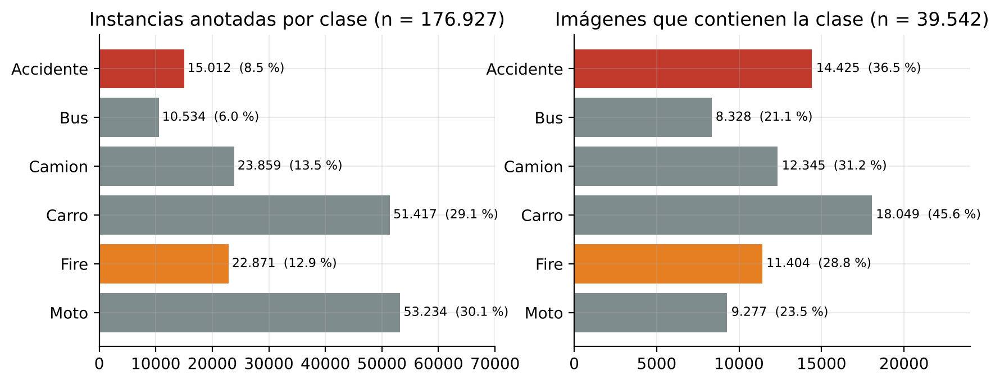{width=16cm}

En número de objetos, `Moto` y `Carro` concentran el 59 % de las instancias, lo que refleja la composición real del tráfico urbano en el que se enmarca el problema: en una escena típica aparecen muchos automóviles y motocicletas y pocos autobuses. Por eso el balance se evalúa también por presencia en imágenes, que es la unidad sobre la que el sistema debe decidir si existe un evento:

| Clase | Imágenes con la clase | % sobre imágenes etiquetadas |
|---|---:|---:|
| Carro | 18.049 | 45,65 % |
| Accidente | 14.425 | 36,48 % |
| Camion | 12.345 | 31,22 % |
| Fire | 11.404 | 28,84 % |
| Moto | 9.277 | 23,46 % |
| Bus | 8.328 | 21,06 % |

La suma supera el 100 % porque una misma imagen puede contener varias clases. Por presencia, la relación entre la clase más frecuente y la menos frecuente baja de 5,1 (objetos) a 2,2 (imágenes), y las dos clases críticas quedan bien representadas: el 65,3 % de las imágenes etiquetadas contiene al menos un `Accidente` o un `Fire`, y el 64,5 % contiene al menos un vehículo. En este sentido, el dataset está balanceado de acuerdo con el problema: las clases de riesgo, que son el objetivo principal del sistema, tienen tantas imágenes de ejemplo como las clases vehiculares, y el desbalance restante en número de objetos corresponde a la densidad natural de vehículos en las escenas. Ese desbalance justifica que el desempeño se analice por clase y no solo con métricas globales.

La densidad media de objetos por imagen varía entre splits:

| Split | Imágenes con etiqueta | Objetos | Objetos por imagen (media) | Mediana | Mínimo | Máximo |
|---|---:|---:|---:|---:|---:|---:|
| Train | 32.588 | 139.047 | 4,27 | 3 | 1 | 58 |
| Valid | 4.641 | 25.062 | 5,40 | 4 | 1 | 54 |
| Test | 2.313 | 12.818 | 5,54 | 4 | 1 | 61 |

El conjunto de test presenta la mayor densidad media de objetos, lo cual puede influir en la dificultad relativa de la evaluación.

### 3.5 Preprocesamiento y formato de anotaciones

Las anotaciones siguen el formato YOLO de detección de objetos:

```
class_id x_center y_center width height
```

donde `class_id` es un entero entre 0 y 5 y las coordenadas están normalizadas al rango [0, 1] respecto al ancho y alto de la imagen. La verificación estructural del dataset arrojó los siguientes resultados:

- **Líneas no vacías en total:** 176.938
- **Líneas con formato de detección válido (5 valores):** 176.927
- **Líneas con formato poligonal (más de 5 valores, cantidad par de coordenadas):** 11
- **Líneas con formato incorrecto:** 0
- **Archivos de etiquetas vacíos:** 0
- **IDs de clase fuera del rango 0–5:** 0
- **Coordenadas normalizadas fuera del rango [0, 1]:** 0

Las 11 líneas poligonales corresponden a la clase `Accidente` y están en 11 archivos distintos (10 de entrenamiento y 1 de test), derivados por aumentación de tres imágenes originales. Cada uno de esos archivos contiene además entre 3 y 8 cajas en formato normal. Al cargar etiquetas, Ultralytics trata como polígonos todos los archivos que contienen al menos una línea con más de seis valores y los convierte a cajas mediante el rectángulo envolvente (`segments2boxes`). En consecuencia, las 11 instancias poligonales sí se usaron como cajas, pero las 58 cajas normales de esos 10 archivos de entrenamiento se reinterpretaron como polígonos de dos puntos y quedaron distorsionadas. Representan el 0,04 % de las cajas de entrenamiento, por lo que su efecto sobre los modelos es despreciable; el script `scripts/fix_polygon_labels.py` corrige el problema convirtiendo cada polígono a caja antes del entrenamiento y debe ejecutarse antes de cualquier reentrenamiento.

Contando todas las líneas de `Accidente`, incluidas las poligonales, la clase suma 15.023 anotaciones; restringiendo el conteo al formato de detección válido, el total es 15.012, que es la cifra usada en las tablas de este capítulo.

### 3.6 Control de calidad

El repositorio incluye tres scripts orientados a la auditoría y limpieza del dataset:

- `scripts/dataset_check.py`: conteo de imágenes, objetos por clase e imágenes que contienen cada clase, y validaciones estructurales (imágenes sin etiqueta, etiquetas sin imagen, IDs inválidos, coordenadas fuera de rango, líneas mal formadas).
- `scripts/fix_polygon_labels.py`: detecta anotaciones poligonales y las convierte a cajas delimitadoras, guardando una copia de seguridad en `dataset/labels_backup/`.
- `scripts/delete_invalid_labels.py`: identifica archivos de etiquetas vacíos o líneas que no cumplen el formato reconocido, con opción de eliminarlos.

Los resultados de aplicar esas validaciones sobre el dataset final son:

- No hay archivos de etiquetas vacíos ni etiquetas sin imagen asociada.
- No hay IDs de clase inválidos ni coordenadas fuera del rango [0, 1].
- No hay líneas con cantidad de valores incorrecta, salvo las 11 líneas poligonales documentadas en la Sección 3.5.
- Solo 4 de las 32.592 imágenes de entrenamiento carecen de etiqueta.

No se realizó una verificación exhaustiva de duplicados o casi duplicados entre splits; dado que Roboflow genera varias versiones aumentadas de una misma imagen (sufijos `.rf.<hash>`), es posible que variantes de una misma imagen original aparezcan en splits distintos. Agrupar las variantes por imagen original antes de partir el dataset es la forma de descartar esa fuga de información en una versión futura.

### 3.7 Características espaciales de las anotaciones

El tamaño y la forma de las cajas delimitadoras varían fuertemente entre clases. Las siguientes medidas se calcularon sobre las 176.927 anotaciones en formato de detección válido:

| Clase | Instancias | Ancho medio | Alto medio | Área media |
|---|---:|---:|---:|---:|
| Accidente | 15.012 | 0,480 | 0,293 | 0,172 |
| Bus | 10.534 | 0,348 | 0,375 | 0,215 |
| Camion | 23.859 | 0,181 | 0,200 | 0,055 |
| Carro | 51.417 | 0,137 | 0,114 | 0,026 |
| Fire | 22.871 | 0,202 | 0,219 | 0,079 |
| Moto | 53.234 | 0,031 | 0,094 | 0,004 |

Estos valores describen el tamaño relativo de las anotaciones:

- `Moto` y `Carro` son las clases con objetos más pequeños en términos relativos; las motocicletas tienen el área media más pequeña y una forma alargada vertical.
- `Bus` y `Accidente` presentan cajas relativamente grandes. La clase `Accidente` tiene un ancho medio mayor que su alto, consistente con anotaciones que abarcan una zona amplia de la calzada.
- `Fire` tiene un área media intermedia y una forma irregular, con posible similitud visual con humo, reflejos o zonas de alto contraste; los resultados de TEST (Capítulo 5) confirman que es la clase más difícil.

La distribución de la relación de aspecto (`ancho / alto`) de todas las cajas es:

| Relación de aspecto | Objetos | % |
|---|---:|---:|
| `< 0,5` (más alto que ancho) | 63.261 | 35,8 % |
| `0,5 – 1,0` | 51.369 | 29,0 % |
| `1,0 – 2,0` | 47.045 | 26,6 % |
| `2,0 – 4,0` | 14.642 | 8,3 % |
| `> 4,0` (más ancho que alto) | 610 | 0,3 % |

La alta proporción de objetos con relación de aspecto menor a 1 refleja la presencia de clases verticales o alargadas, especialmente `Moto`.

{width=12cm}

### 3.8 Versiones y trazabilidad

El archivo `dataset/data.yaml` es el punto central de configuración del dataset:

```yaml
train: ../train/images
val: ../valid/images
test: ../test/images

nc: 6
names: ['Accidente', 'Bus', 'Camion', 'Carro', 'Fire', 'Moto']

roboflow:
  workspace: omars-workspace-mjqor
  project: smartroadaiv1-q0ubo
  version: 1
  license: CC BY 4.0
  url: https://universe.roboflow.com/omars-workspace-mjqor/smartroadaiv1-q0ubo/dataset/1
```

La trazabilidad del dataset se apoya en el archivo de configuración (fuente, versión, licencia y orden de clases), en la resolución uniforme de las imágenes, en anotaciones YOLO legibles y verificables, y en los recuentos documentados en este capítulo. Como aspectos por mejorar quedan registrar por escrito los criterios de la actualización de octubre de 2026 (imágenes eliminadas y decisiones de re-etiquetado) y el método de partición, que en este caso es el de la exportación de Roboflow.

| Versión | Periodo | Imágenes | Etiquetas | Objetos | Notas |
|---|---|---:|---:|---:|---|
| Histórica | Antes de octubre de 2026 | 45.059 | 45.059 | No disponible | Reportada en `AGENTS.md` y `documentation/AUDITORIA_Y_REORGANIZACION.md` |
| Actualizada (final) | Octubre de 2026 | 39.546 | 39.542 | 176.927 | Recuento del 28 de octubre de 2026; 11 líneas poligonales y 4 imágenes de train sin etiqueta |


---

## Capítulo 4. Selección de modelos de Machine Learning y estado del arte

### 4.1 Detección de objetos en seguridad vial

La detección de objetos en escenarios de tránsito busca localizar y clasificar, en una imagen o secuencia de video, a los actores y eventos relevantes para la seguridad vial: vehículos, motocicletas, autobuses, accidentes, incendios, peatones y señales de tránsito [1][2]. Desde la aparición de las arquitecturas basadas en aprendizaje profundo, el campo ha dejado de depender de descriptores artificiales (Haar, HOG, SIFT) para adoptar redes convolucionales (CNN) capaces de aprender representaciones jerárquicas directamente de los datos [3]. Esta transición permitió mejorar drásticamente la precisión en condiciones adversas como baja iluminación, oclusión parcial, cambios de escala y fondos complejos, situaciones frecuentes en cámaras de tráfico urbano e interurbano.

En el contexto de SmartRoad AI, el problema se acota a seis clases (`Accidente`, `Bus`, `Camion`, `Carro`, `Fire`, `Moto`) que combinan vehículos y eventos de riesgo. Las aplicaciones prácticas de un detector con esta taxonomía incluyen: monitoreo automático de incidentes en cámaras de peaje y semáforos, generación de alertas tempranas de incendio vehicular, y conteo/clasificación de flujo vehicular para la gestión de tráfico [1]. Estos escenarios imponen dos restricciones de diseño: (i) la capacidad de operar en tiempo real o cerca de tiempo real, y (ii) la robustez frente a clases poco frecuentes pero críticas, como accidentes e incendios, que suelen estar subrepresentadas en los datasets [2].

### 4.2 Familia YOLO: evolución y características

La familia YOLO (*You Only Look Once*) definió el paradigma de detectores de una sola etapa: una sola pasada por la red predice simultáneamente la clase y la ubicación de todos los objetos de la imagen, lo que reduce la latencia respecto a los detectores de dos etapas (R-CNN, Fast R-CNN, Faster R-CNN) [4]. Las versiones posteriores han mejorado sucesivamente la relación velocidad–precisión, la escalabilidad a dispositivos de borde y la facilidad de entrenamiento.

**YOLOv8** (Ultralytics, 2023) introduce una cabeza *anchor-free* dividida (*decoupled head*), un backbone y un neck rediseñados basados en CSPDarknet, y una API unificada para detección, segmentación, clasificación, pose y *oriented bounding boxes* [5]. La eliminación de *anchors* predeterminados simplifica el ajuste de hiperparámetros y reduce la dependencia de la forma estadística de los objetos en el conjunto de entrenamiento. YOLOv8 se convirtió en una referencia estable y ampliamente documentada para proyectos de detección en tiempo real, por lo que su inclusión en SmartRoad AI permite comparar contra una línea base consolidada.

**YOLOv10** (Wang et al., 2024) avanza hacia la detección *end-to-end* sin NMS (*non-maximum suppression*) mediante el mecanismo de *consistent dual assignments* y un diseño del modelo guiado simultáneamente por eficiencia y precisión [6]. Al evitar la post-procesación por NMS, YOLOv10 reduce la latencia de inferencia y facilita el despliegue en pipelines de bajo costo computacional. Además, los experimentos reportados en COCO muestran que YOLOv10 mejora la frontera rendimiento–eficiencia con respecto a generaciones anteriores y a RT-DETR a escala similar [6].

**YOLO11** (Ultralytics, 2024) reemplaza los módulos C2f por bloques C3k2 y añade el módulo C2PSA (*Cross-Stage Partial Spatial Attention*) en el backbone, mejorando la extracción de características espaciales y el manejo de oclusiones sin un crecimiento desproporcionado del número de parámetros [7]. Según la documentación oficial, YOLO11m alcanza mayor precisión en COCO que YOLOv8m con un 22 % menos de parámetros [7]. Su inclusión permite evaluar si las mejoras de atención espacial se traducen en ganancias sobre las clases pequeñas del dataset SmartRoad AI, especialmente `Moto`.

Las variantes *nano* (`n`) de cada generación fueron elegidas para mantener un modelo compacto y rápido, coherente con la posibilidad futura de despliegue en dispositivos de borde o en cámaras con recursos limitados.

### 4.3 Transformers para detección: DETR y RT-DETR

Carion et al. (2020) propusieron DETR (*Detection Transformer*), el primer detector *end-to-end* basado exclusivamente en transformadores [8]. DETR utiliza un encoder transformer para procesar características de la imagen, un decoder transformer para refinar un conjunto fijo de *queries* de objeto, y una función de costo de emparejamiento bipartita (*bipartite matching*) para asignar predicciones a ground-truth. Esta formulación elimina la necesidad de *anchors*, regresores de propuesta y NMS, simplificando conceptualmente el pipeline de inferencia.

El principal inconveniente de DETR original es su alto costo computacional y memoria, que dificulta su uso en aplicaciones en tiempo real. Para superar esta limitación, Zhao et al. (2024) presentaron RT-DETR (*Real-Time Detection Transformer*) [9]. RT-DETR incorpora un *encoder híbrido eficiente* que separa la interacción intraescala de la fusión interescala, una selección de *queries* consciente de la incertidumbre (*uncertainty-minimal query selection*) para mejorar la calidad de las consultas iniciales, y la posibilidad de ajustar la velocidad variando el número de capas del decoder sin reentrenar. En COCO val2017, RT-DETR-L alcanza 53,0 % AP a 114 FPS en GPU T4, superando a los detectores YOLO contemporáneos de escala comparable [9]. Esta combinación de precisión y ausencia de NMS justifica su inclusión como contraparte transformer del experimento.

### 4.4 Criterios de selección para SmartRoad AI

La elección de cuatro modelos para SmartRoad AI responde a cuatro criterios principales:

1. **Cobertura del espectro velocidad–precisión.** Las tres variantes YOLO nano representan el estado del arte en detección en tiempo real con bajo consumo computacional, mientras que RT-DETR-L explora el extremo de mayor precisión sin post-procesamiento NMS.
2. **Relevancia para el dataset.** El dataset contiene seis clases, algunas pequeñas y alargadas (`Moto`) y otras amplias o irregulares (`Accidente`, `Fire`). Comparar arquitecturas con diferentes mecanismos de atención y asignación permite observar cuál se adapta mejor a estas formas.
3. **Acceso a pesos preentrenados y facilidad de implementación.** Todos los modelos están disponibles en la API de Ultralytics, lo que garantiza un pipeline de entrenamiento, validación y exportación homogéneo.
4. **Base de comparación temporal.** YOLOv8 es la generación anterior consolidada; YOLOv10 introduce entrenamiento sin NMS; YOLO11 incorpora atención espacial; RT-DETR-L representa la línea transformer optimizada para tiempo real. Juntos permiten caracterizar el margen de mejora disponible entre 2023 y 2024.

Cada arquitectura se entrena y evalúa de manera independiente; su combinación mediante fusión ponderada se formula en el Capítulo 6 y se implementa en la aplicación del Capítulo 7.

### 4.5 Modelos seleccionados y variantes exactas

| Modelo | Variante | Peso base | Script de entrenamiento |
|---|---|---|---|
| YOLOv8 | YOLOv8n | `models/base/yolov8n.pt` | `scripts/train_yolov8.py` |
| YOLOv10 | YOLOv10n | `models/base/yolov10n.pt` | `scripts/train_yolov10.py` |
| YOLO11 | YOLO11n | `models/base/yolo11n.pt` | `scripts/train_yolov11.py` |
| RT-DETR | RT-DETR-L | `models/base/rtdetr-l.pt` | `scripts/train_rtdetr.py` |

La columna "Variante" indica el tamaño exacto del modelo entrenado en el experimento (`n` = *nano*, la versión más ligera de cada familia). La columna "Peso base" señala el checkpoint preentrenado en COCO utilizado como punto de partida, y "Script de entrenamiento" el archivo de Python que orquesta la llamada a `model.train()` dentro del proyecto.

---

## Capítulo 5. Metodología experimental, simulación y análisis de resultados

### 5.1 Entorno de desarrollo y reproducibilidad

El proyecto se desarrolla en **Python** sobre el framework **PyTorch**, utilizando la biblioteca **Ultralytics** como interfaz unificada para entrenar, validar y ejecutar inferencia con los modelos YOLOv8, YOLOv10, YOLO11 y RT-DETR. Los entrenamientos locales especifican `device='0'`, lo que indica una GPU NVIDIA disponible en la máquina de desarrollo. El entrenamiento de YOLO11n se ejecutó en **Google Colab** (`device='0'`, ruta `/content/...`), lo que sugiere el uso de una GPU proporcionada por el entorno cloud.

No se encontró en el repositorio un archivo `requirements.txt`, `environment.yml`, `pyproject.toml` ni un log de instalación que documente las versiones exactas de Python, PyTorch, CUDA, cuDNN ni Ultralytics. Esta ausencia constituye un riesgo de reproducibilidad: sin fijar estas versiones, los resultados podrían variar al reejecutar el proyecto en otro entorno. Los `args.yaml` de cada experimento sí conservan la configuración interna de Ultralytics (por ejemplo, `amp: true`, `deterministic: true`, `mosaic: 1.0`, `close_mosaic: 10`), pero no la versión del paquete.

### 5.2 Pipeline general de entrenamiento

El pipeline seguido por los cuatro modelos es homogéneo gracias a la API de Ultralytics:

1. **Carga del modelo base** desde `models/base/`.
2. **Configuración del dataset** a través de `data.yaml` (local, temporal o en Colab).
3. **Entrenamiento** con `model.train(...)`, especificando `project`, `name`, `epochs`, `imgsz`, `batch`, `device`, `seed`, `optimizer`, etc.
4. **Validación interna** al final de cada época sobre el split de validación.
5. **Evaluación final sobre TEST** con `model.val(split="test")`.
6. **Predicciones visuales y pruebas con imágenes externas** mediante `model.predict(...)`.

Todos los scripts fijan `imgsz=640`, `iou=0.7` y una confianza mínima de `0.25` para las predicciones externas. La única excepción sustancial es YOLO11n, cuyo entrenamiento se reanudó (`resume: true`) desde un checkpoint intermedio en Google Drive, con `exist_ok: true`.

### 5.3 Configuración experimental por modelo

| Modelo | Épocas | imgsz | batch | Dispositivo | Optimizador | Seed | Data YAML |
|---|---|---|---|---|---|---|---|
| YOLOv8n | 20 | 640 | 2 | GPU local (`device=0`) | auto | 0 | `C:/Users/omarg/.../Entrenamiento_DataScience/dataset/data.yaml` |
| YOLOv10n | 20 | 640 | 2 | GPU local (`device=0`) | auto | 42 | YAML temporal (`AppData/Local/Temp/data_gtr_vqp5_smartroad_yolov10.yaml`) |
| YOLO11n | 50 | 640 | 16 | GPU Colab (`device=0`) | MuSGD | 0 | `/content/data_colab.yaml` (reanudado desde Google Drive) |
| RT-DETR-L | 25 | 640 | 2 | GPU local (`device=0`) | auto | 0 | `dataset/data.yaml` |

Tres aspectos de esta tabla son importantes para la interpretación posterior:

- **Dataset binario no uniforme:** YOLOv8n apunta a una ruta en el equipo de Omar, YOLO11n a una copia en Colab (`/content/data_colab.yaml`) y YOLOv10n/RT-DETR-L a una copia local. El equipo afirma que todos usaron la versión actual del dataset, pero el repositorio no permite verificarlo binariamente.
- **Batch size diferente:** YOLO11n usó batch 16, mientras que los modelos locales usaron batch 2. Esto afecta la estimación de estadísticas de batch normalization y la estabilidad del gradiente.
- **Reanudación:** YOLO11n se entrenó con `resume: true` desde `last.pt`. Los demás modelos partieron de cero desde el peso base preentrenado en COCO.

### 5.4 Métricas de evaluación

Las métricas empleadas son las estándar en detección de objetos:

- **IoU (*Intersection over Union*):** razón entre el área de intersección y el área de unión de una caja predicha y su ground-truth. Una detección se considera verdadero positivo cuando IoU ≥ umbral (típicamente 0.5).
- **Precision:** proporción de detecciones predichas que son correctas, \(Precision = TP / (TP + FP)\).
- **Recall:** proporción de objetos reales detectados, \(Recall = TP / (TP + FN)\).
- **mAP@50:** *mean Average Precision* promediado sobre las seis clases, usando IoU ≥ 0.5 como criterio de acierto.
- **mAP@50-95:** promedio de mAP calculado a 10 umbrales de IoU entre 0.50 y 0.95, con paso 0.05. Es una métrica más estricta que refleja la calidad de localización.

Es fundamental distinguir entre **métricas de validación** (calculadas por Ultralytics al final de cada época sobre el split `valid`) y **métricas de TEST** (calculadas una vez terminado el entrenamiento con `split="test"`). En un informe académico no deben mezclarse: la validación guía el ajuste del modelo, mientras que TEST mide la generalización sobre datos no vistos durante el entrenamiento ni la selección de hiperparámetros.

### 5.5 Resultados de entrenamiento y validación

La tabla siguiente resume las métricas finales de validación extraídas de la última fila de cada `results.csv`:

| Modelo | Épocas | P (val) | R (val) | mAP@50 (val) | mAP@50-95 (val) | Pérdidas finales (box / cls / dfl) |
|---|---:|---:|---:|---:|---:|---|
| YOLOv8n | 20 | 0,782 | 0,729 | 0,801 | 0,545 | 1,096 / 0,918 / 1,190 |
| YOLOv10n | 20 | 0,805 | 0,759 | 0,820 | 0,540 | 1,300 / 0,736 / 1,236 |
| YOLO11n | 50 | 0,832 | 0,805 | 0,871 | 0,622 | 1,011 / 0,665 / 1,052 |
| RT-DETR-L | 25 | 0,831 | 0,799 | 0,855 | 0,606 | 0,353 / 0,437 / 0,150* |

\* Las pérdidas de RT-DETR-L corresponden a `giou_loss`, `cls_loss` y `l1_loss`, respectivamente, ya que esta arquitectura no utiliza `dfl_loss`.


{width=16cm}


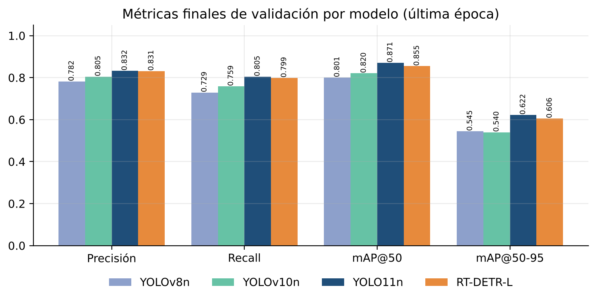{width=15cm}


{width=16cm}

Todas las curvas de pérdida descendieron de forma estable a lo largo del entrenamiento, sin signos evidentes de divergencia. YOLO11n obtuvo la mejor validación en ambas métricas de mAP, seguido de cerca por RT-DETR-L. YOLOv10n superó ligeramente a YOLOv8n en mAP@50, aunque ambos modelos de 20 épocas quedaron por debajo de YOLO11n y RT-DETR-L.

### 5.6 Resultados de evaluación sobre TEST

YOLO11n es el único modelo con un archivo de métricas de TEST persistido en texto (`evaluation/yolov11/test_final/metrics_summary.txt`):

| Métrica | Valor |
|---|---:|
| Precision | 0,8358 |
| Recall | 0,8068 |
| mAP@50 | 0,8716 |
| mAP@50-95 | 0,6225 |

El desempeño por clase (mAP@50-95) sobre TEST fue:

| Clase | mAP@50-95 |
|---|---:|
| Accidente | 0,7411 |
| Bus | 0,7311 |
| Camion | 0,6472 |
| Carro | 0,7078 |
| Fire | 0,3698 |
| Moto | 0,5382 |

La clase `Fire` presenta el valor más bajo (0,3698), lo que sugiere que, a pesar de contar con más de 22.000 instancias de entrenamiento, la localización precisa o la separación visual de fuego frente a fondos similares sigue siendo un desafío. `Accidente` y `Bus` obtienen los mejores resultados por clase, mientras que `Moto` y `Camion` quedan en niveles intermedios.

Para YOLOv8n, YOLOv10n y RT-DETR-L no existe un archivo de texto equivalente; sin embargo, las carpetas `evaluation/{yolov8,yolov10,rtdetr}/test_final/` conservan la curva Precisión–Recall (`BoxPR_curve.png`) que Ultralytics genera durante `model.val(split="test")`. La leyenda de esa curva registra el AP@50 de cada clase y el mAP@50 global sobre TEST, lo que permite reconstruir de forma trazable la comparación de los cuatro modelos en esta métrica:

| Clase | YOLOv8n | YOLOv10n | YOLO11n | RT-DETR-L |
|---|---:|---:|---:|---:|
| Accidente | 0,924 | 0,934 | 0,950 | **0,958** |
| Bus | 0,809 | 0,819 | **0,897** | 0,894 |
| Camion | 0,868 | **0,875** | 0,853 | 0,825 |
| Carro | 0,888 | 0,891 | **0,904** | 0,889 |
| Fire | 0,538 | 0,614 | 0,695 | **0,726** |
| Moto | 0,926 | 0,918 | **0,931** | 0,861 |
| **mAP@50 global** | 0,825 | 0,842 | **0,872** | 0,859 |

Fuente: leyendas de `evaluation/<modelo>/test_final/BoxPR_curve.png` (el valor de YOLO11n coincide con el 0,8716 de `metrics_summary.txt`). La sección 7.9 complementa esta tabla con precisión, recall y mAP@50 de los cuatro modelos calculados con un evaluador común sobre el split TEST actual.


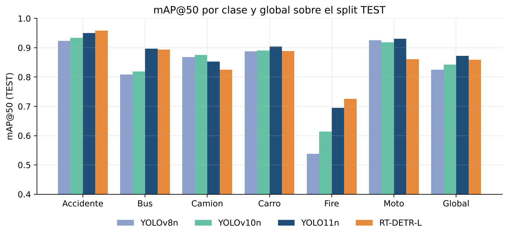{width=16cm}

El resultado más relevante de la tabla es que **ningún modelo domina en todas las clases**: YOLO11n obtiene el mejor mAP@50 global y lidera en `Bus`, `Carro` y `Moto`; RT-DETR-L lidera en las dos clases críticas de riesgo (`Accidente` y `Fire`), y YOLOv10n en `Camion`. Esta complementariedad por clase es la evidencia empírica que motiva el modelo de acoplamiento del Capítulo 6.

{width=16cm}


{width=16cm}


### 5.7 Pruebas con imágenes externas

Se dispone de 25 imágenes en `external_data/images/`, sin etiquetas ground-truth. Sobre ellas se ejecutaron inferencias con YOLOv8n, YOLOv10n y RT-DETR-L. Los resúmenes cualitativos son:

| Modelo | Imágenes procesadas | Detecciones totales | Accidente | Bus | Camion | Carro | Fire | Moto |
|---|---:|---:|---:|---:|---:|---:|---:|---:|
| YOLOv8n | 19 | 34 | 7 | 2 | 1 | 9 | 5 | 10 |
| YOLOv10n | 19 | 50 | 4 | 5 | 0 | 11 | 4 | 26 |
| RT-DETR-L | 25 | 303 | 11 | 33 | 31 | 111 | 6 | 111 |

Hay dos inconsistencias que deben aclararse:

1. **Número de imágenes procesadas:** YOLOv8n e YOLOv10n reportan 19 imágenes, mientras que la carpeta actual contiene 25. Esto puede deberse a que, en el momento de ejecutar las pruebas, la carpeta tenía menos imágenes, o a que el script filtró algunas extensiones. Dado que el script actual acepta `.jpeg`, todas las imágenes actuales deberían procesarse.
2. **Checkpoint de YOLOv8n:** el resumen externo de YOLOv8n indica que usó `experiments/yolov8/entrenamiento_02_20_epochs_definitivo/weights/best.pt`, una ruta que **no existe en el repositorio actual**. El script actual apunta a `experiments/yolov8/yolov8n_20epochs-2/weights/best.pt`. Esto indica que el resumen externo proviene de una ejecución anterior o de una rama distinta.

Además, RT-DETR-L generó 303 detecciones sobre 25 imágenes (promedio de 12,1 por imagen), muy por encima de YOLOv8n (1,8 por imagen) y YOLOv10n (2,6 por imagen). Sin etiquetas de referencia no es posible determinar si este comportamiento refleja mayor sensibilidad o un exceso de falsos positivos; por eso estas pruebas se reportan solo como exploración cualitativa de generalización.

{width=15cm}


### 5.8 Análisis comparativo

Desde la perspectiva de las métricas de validación disponibles, el orden de desempeño es:

1. **YOLO11n** — mejor mAP@50 (0,871) y mAP@50-95 (0,622).
2. **RT-DETR-L** — segundo en ambas métricas (0,855 y 0,606), con una arquitectura completamente distinta.
3. **YOLOv10n** — mAP@50 0,820, ligeramente por encima de YOLOv8n.
4. **YOLOv8n** — mAP@50 0,801, mAP@50-95 0,545.

En TEST, el mAP@50 global reproduce el mismo orden: YOLO11n (0,872) > RT-DETR-L (0,859) > YOLOv10n (0,842) > YOLOv8n (0,825). Para YOLO11n, además, se dispone del resto de métricas (mAP@50-95 = 0,6225), consistentes con su validación, lo que indica que el modelo no sufrió sobreajuste severo respecto al split de validación.

No obstante, **esta comparación tiene limitaciones metodológicas importantes**:

- Los modelos no fueron entrenados con exactamente los mismos hiperparámetros: YOLO11n tuvo 50 épocas y batch 16, mientras que los demás usaron 20–25 épocas y batch 2.
- La versión binaria exacta del dataset no es idéntica en todos los `args.yaml`: YOLOv8n apunta a una ruta externa, YOLO11n a Colab, y los otros dos a copias locales.
- Para tres de los cuatro modelos solo se dispone del mAP@50 de TEST (reconstruido desde la curva PR); faltan precisión, recall y mAP@50-95.

Por estas razones, el ranking anterior debe interpretarse como una **comparación explorativa** de arquitecturas bajo condiciones aproximadas, no como una evaluación estrictamente controlada. Un experimento completamente reproducible requeriría entrenar los cuatro modelos desde el mismo dataset, con el mismo batch size, mismas épocas y una semilla fijada, y persistir explícitamente las métricas de TEST.

---

## Capítulo 6. Modelo matemático de las arquitecturas y del sistema conjunto

### 6.1 Fundamentos matemáticos de YOLO

La familia YOLO trata la detección como un problema de regresión y clasificación simultáneas sobre una imagen de entrada \(I \in \mathbb{R}^{H \times W \times 3}\). La red se divide conceptualmente en tres partes:

1. **Backbone:** extrae características jerárquicas a diferentes resoluciones espaciales.
2. **Neck:** fusiona las características de diferentes escalas (típicamente mediante FPN/PAN o variantes como CSP).
3. **Head:** produce, para cada celda de la grilla de salida y cada escala, un vector de predicción.

La Figura 11 resume el flujo común de las tres variantes YOLO utilizadas.


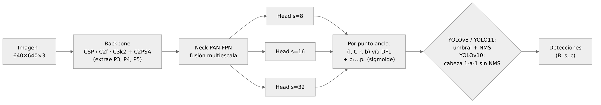{width=16cm}


**Decodificación de cajas (anchor-free).** YOLOv8, YOLOv10 y YOLO11 no usan cajas ancla predefinidas. Cada celda de la grilla de stride \(s\) define un punto ancla \((x_a, y_a)\) y la cabeza predice, para cada uno de los cuatro bordes, un vector de logits \(\mathbf{z}_e \in \mathbb{R}^{n}\) (\(n = 16\) en Ultralytics, parámetro `reg_max`). La distancia esperada del borde \(e \in \{l, t, r, b\}\) se obtiene como el valor esperado de una distribución discreta:

\[
\hat{d}_e = \sum_{i=0}^{n-1} i \cdot \operatorname{softmax}(\mathbf{z}_e)_i ,
\]

y la caja en píxeles se reconstruye como:

\[
\hat{B} = s \cdot \big(x_a - \hat{d}_l,\; y_a - \hat{d}_t,\; x_a + \hat{d}_r,\; y_a + \hat{d}_b\big).
\]

Paralelamente, la rama de clasificación entrega \(C = 6\) puntuaciones independientes \(\hat{p}_c = \sigma(z_c)\), con \(\sigma\) la función sigmoide; la confianza de la detección es \(s = \max_c \hat{p}_c\) y la clase predicha \(\hat{c} = \arg\max_c \hat{p}_c\).


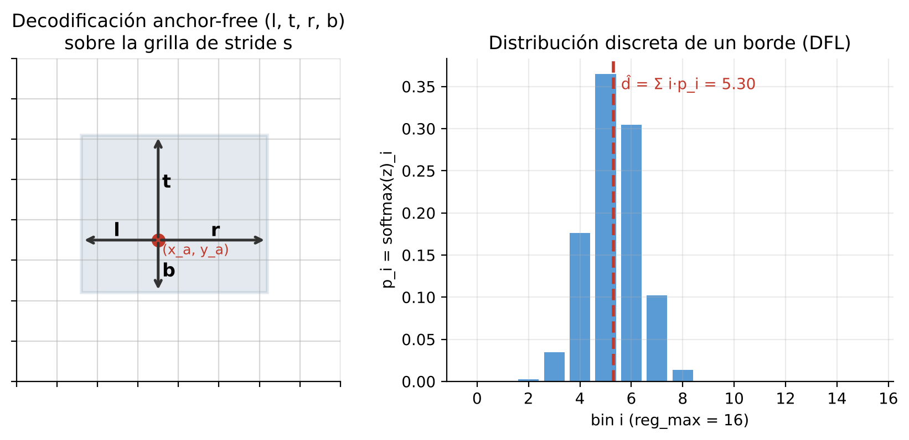{width=15cm}


**Asignación de etiquetas.** Durante el entrenamiento, YOLOv8 y YOLO11 emplean el *Task-Aligned Assigner*, que para cada par (punto ancla, objeto real) calcula una métrica de alineación que combina clasificación y localización:

\[
t = \hat{p}_{c^*}^{\,\alpha} \cdot \mathrm{IoU}(\hat{B}, B^*)^{\beta}, \qquad \alpha = 0{,}5,\; \beta = 6,
\]

y asigna como positivos los \(k\) anclas con mayor \(t\) (\(k = 10\)). YOLOv10 añade una segunda cabeza con asignación uno-a-uno (*consistent dual assignments*): ambas cabezas comparten la métrica \(m(\alpha,\beta) = s \cdot p^{\alpha} \cdot \mathrm{IoU}^{\beta}\); la cabeza uno-a-muchos aporta supervisión rica en entrenamiento y la uno-a-uno, usada en inferencia, produce una sola predicción por objeto y elimina la necesidad de NMS [6].

**Función de pérdida.** La pérdida total combina tres términos:

\[
\mathcal{L}_{YOLO} = \lambda_{box}\, \mathcal{L}_{CIoU} + \lambda_{cls}\, \mathcal{L}_{BCE} + \lambda_{dfl}\, \mathcal{L}_{DFL}, \qquad (\lambda_{box}, \lambda_{cls}, \lambda_{dfl}) = (7{,}5;\; 0{,}5;\; 1{,}5),
\]

valores por defecto de Ultralytics registrados en los `args.yaml` (`box`, `cls`, `dfl`). \(\mathcal{L}_{CIoU} = 1 - \mathrm{CIoU}\) penaliza la localización (Sección 6.3), \(\mathcal{L}_{BCE}\) es la entropía cruzada binaria de la clasificación y la *Distribution Focal Loss* concentra la masa de probabilidad de cada borde en los dos bins que rodean la distancia real \(y\) (con \(y_i \le y \le y_{i+1}\)):

\[
\mathcal{L}_{DFL} = -\big[(y_{i+1} - y)\,\log S_i + (y - y_i)\,\log S_{i+1}\big],
\]

donde \(S_i\) es la probabilidad softmax del bin \(i\).

En la inferencia, las predicciones crudas se filtran por umbral de confianza y, salvo en YOLOv10 que entrena sin NMS, se aplica **NMS** para eliminar cajas redundantes:

\[
s_i \leftarrow \begin{cases}
s_i, & \text{IoU}(B_i, B_{max}) < \tau_{NMS} \\[6pt]
0, & \text{en otro caso},
\end{cases}
\]

donde \(B_{max}\) es la caja de mayor confianza y \(\tau_{NMS}\) el umbral de superposición permitido (0,7 en todos los experimentos, parámetro `iou` de los `args.yaml`).

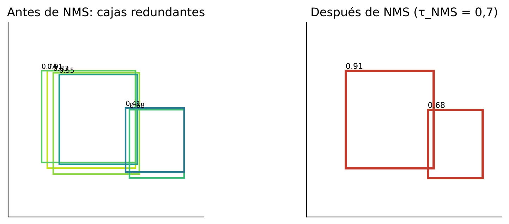{width=13cm}


### 6.2 Fundamentos matemáticos de RT-DETR


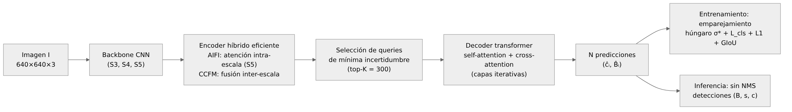{width=16cm}

RT-DETR reformula la detección como un problema de *set prediction*. Dada una imagen \(I\), un backbone CNN produce un mapa de características de menor resolución. Un **encoder híbrido** transforma dichas características en una secuencia de embeddings de imagen, desacoplando la interacción intraescala de la fusión interescala. A continuación, un **decoder transformer** recibe un conjunto fijo de *queries* aprendibles \(\mathbf{q} = \{q_1, \dots, q_N\}\) y los refina iterativamente en capas cruzadas de *self-attention* y *cross-attention* con los embeddings de imagen.

La salida de cada capa del decoder es una predicción \(\hat{y}_i = (\hat{c}_i, \hat{B}_i)\), donde \(\hat{c}_i\) es la distribución sobre clases y \(\hat{B}_i\) las coordenadas de la caja. Para entrenar sin *anchors* y sin NMS, DETR utiliza un **emparejamiento bipartita** mediante el algoritmo húngaro. Dado un conjunto de ground-truth \(Y = \{y_1, \dots, y_M\}\) (con \(M \le N\)) y predicciones \(\hat{Y} = \{\hat{y}_1, \dots, \hat{y}_N\}\), se busca la permutación \(\sigma^*\) que minimice el costo total:

\[
\sigma^* = \arg\min_{\sigma \in \mathfrak{S}_N} \sum_{i=1}^{M} \mathcal{C}_{match}(y_i, \hat{y}_{\sigma(i)}) + \sum_{i=M+1}^{N} \mathcal{C}_{no\text{-}obj}(\hat{y}_{\sigma(i)}).
\]

El costo de emparejamiento combina la probabilidad asignada a la clase correcta y el error de localización:

\[
\mathcal{C}_{match}(y_i, \hat{y}_j) = -\,\hat{p}_j(c_i) + \lambda_{L1}\, \lVert B_i - \hat{B}_j \rVert_1 + \lambda_{giou}\, \big(1 - \mathrm{GIoU}(B_i, \hat{B}_j)\big),
\]

y la pérdida de entrenamiento se evalúa sobre la permutación óptima \(\sigma^*\):

\[
\mathcal{L}_{RT\text{-}DETR} = \sum_{i=1}^{N} \Big[ \lambda_{cls}\, \mathcal{L}_{cls}\big(c_i, \hat{p}_{\sigma^*(i)}\big) + \mathbb{1}_{\{c_i \neq \varnothing\}} \Big( \lambda_{L1}\, \lVert B_i - \hat{B}_{\sigma^*(i)} \rVert_1 + \lambda_{giou}\, \mathcal{L}_{GIoU}\big(B_i, \hat{B}_{\sigma^*(i)}\big) \Big) \Big],
\]

con \((\lambda_{cls}, \lambda_{L1}, \lambda_{giou}) = (1, 5, 2)\) en la implementación de Ultralytics. \(\mathcal{L}_{cls}\) es una *Varifocal Loss* que usa el IoU como objetivo suave de clasificación, y los términos L1 y GIoU corresponden exactamente a las columnas `l1_loss` y `giou_loss` registradas en el `results.csv` de RT-DETR-L. La pérdida se aplica a la salida de cada capa del decoder (supervisión auxiliar). Como cada objeto real queda emparejado con una sola query, RT-DETR elimina por diseño la etapa de NMS, a costa de un mayor consumo de memoria en el decoder.

### 6.3 Funciones de pérdida y métricas

A continuación se formalizan las funciones y métricas utilizadas en los experimentos.

**IoU.** Dadas dos cajas \(A\) y \(B\):

\[
\text{IoU}(A, B) = \frac{|A \cap B|}{|A \cup B|}.
\]

**GIoU.** Generaliza IoU para cajas no solapadas:

\[
\text{GIoU}(A, B) = \text{IoU}(A, B) - \frac{|C \setminus (A \cup B)|}{|C|},
\]

donde \(C\) es la caja envolvente mínima de \(A\) y \(B\).

**CIoU.** Incorpora solapamiento, distancia entre centroides y relación de aspecto:

\[
\text{CIoU}(A, B) = \text{IoU}(A, B) - \frac{\rho^2(A_{ctr}, B_{ctr})}{d^2} - \alpha \, v,
\]

con \(\rho\) la distancia euclídea entre centroides, \(d\) la diagonal de \(C\), \(\alpha\) un factor de equilibrio y \(v\) un término de relación de aspecto.


{width=16cm}

**Pérdida de caja.** Tanto YOLO (CIoU) como RT-DETR (GIoU/L1) definen:

\[
\mathcal{L}_{box} = 1 - \text{IoU-based}(A, B).
\]

**Entropía cruzada binaria para clasificación.** Para una clase \(c\) con etiqueta \(y_c \in \{0,1\}\):

\[
\mathcal{L}_{cls} = -\sum_{c=1}^{C} \Big[ y_c \log(\hat{p}_c) + (1 - y_c) \log(1 - \hat{p}_c) \Big].
\]


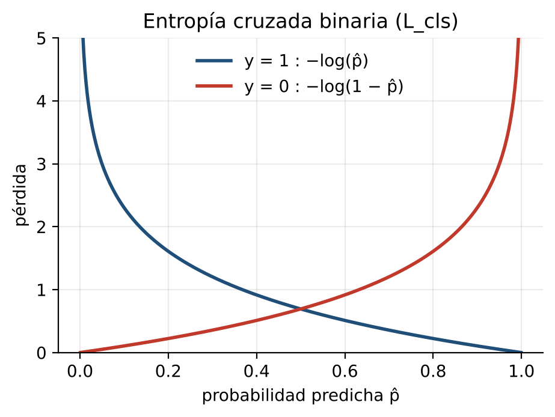{width=10cm}

**Average Precision (AP).** Para una clase, AP es el área bajo la curva Precision–Recall:

\[
\text{AP} = \int_0^1 p(r)\, dr,
\]

donde \(p(r)\) es la precisión máxima alcanzada para un recall mayor o igual a \(r\). En la práctica se interpola en 101 puntos.

**mAP.** Promedio de AP sobre todas las clases del problema:

\[
\text{mAP} = \frac{1}{C} \sum_{c=1}^{C} \text{AP}_c.
\]

Las variantes mAP@50 y mAP@50-95 difieren en el umbral de IoU exigido para considerar un acierto:

\[
\text{mAP@50-95} = \frac{1}{10} \sum_{\tau \in \{0{,}50;\,0{,}55;\,\dots;\,0{,}95\}} \text{mAP}_{\tau}.
\]

Gráficamente, el AP de cada clase es el área bajo su curva Precisión–Recall (Figura 8); las clases con curvas que caen pronto, como `Fire`, son las que reducen el mAP global.

**F1.** Media armónica de precisión y recall, usada para elegir el umbral de confianza de operación:

\[
F_1 = \frac{2\, P\, R}{P + R}.
\]


### 6.4 Modelo de acoplamiento multimodelo

El repositorio incluye el documento `documentation/MARCO_TEORICO_MODELO_MATEMATICO.md`, que propone un **ensamble heterogéneo de cuatro detectores** basado en *Weighted Boxes Fusion* (WBF) [10] con un esquema de confianza asimétrica. A continuación se presenta la formulación, implementada en `app/app_modules/decision_engine.py` (sección 7.7).

**Justificación teórica.** Para \(K\) estimadores con varianza media \(\sigma^2\) y correlación media \(\rho\) entre sus errores, el error esperado del promedio es:

\[
\mathbb{E}\big[(\bar{f} - y)^2\big] = \frac{1}{K}\,\sigma^2 + \frac{K-1}{K}\,\rho\,\sigma^2 .
\]

El ensamble solo reduce el error si \(\rho < 1\), es decir, si los modelos se equivocan en sitios distintos. La combinación de tres CNN (sesgo inductivo local) y un transformer (atención global) busca precisamente esa diversidad, y la Tabla de la Sección 5.6 lo respalda: el mejor modelo cambia según la clase.


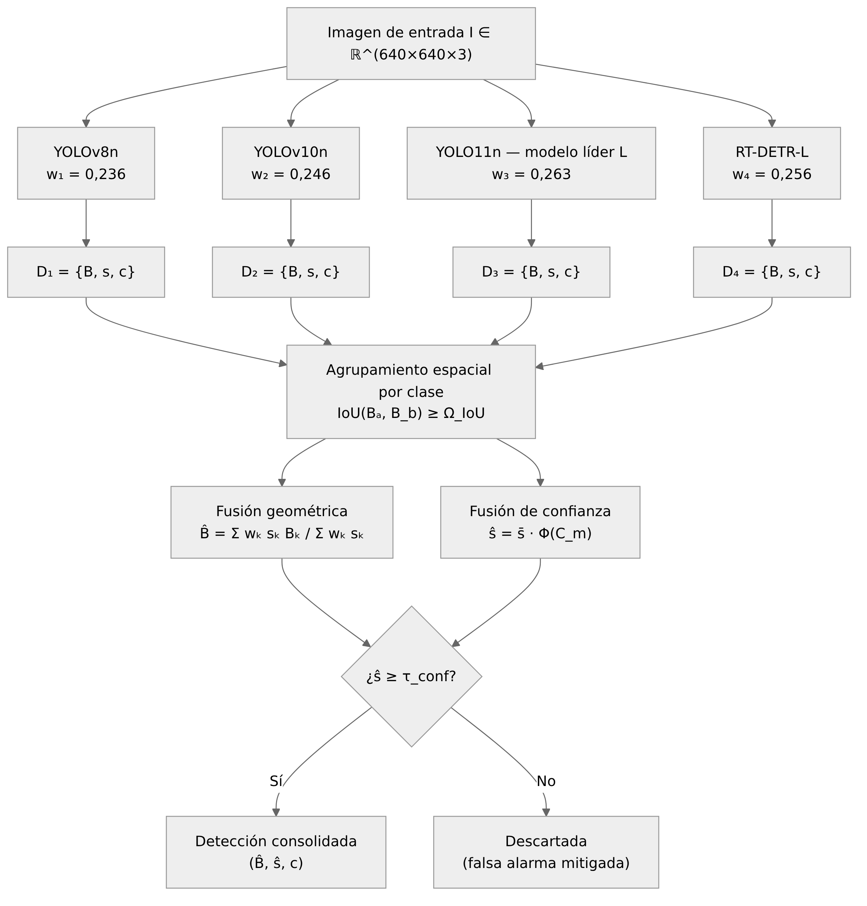{width=13cm}

Dada una imagen \(I\), cada modelo \(k \in \{1,2,3,4\}\) produce un conjunto de detecciones:

\[
\mathcal{D}_k = \{(B_{k,i},\, s_{k,i},\, c_{k,i})\}_{i=1}^{N_k},
\]

donde \(B\) es la caja, \(s\) la confianza y \(c\) la clase. El procedimiento consta de cuatro pasos:

1. **Ponderación por modelo.** A partir de una métrica de calidad \(P_k\) (por ejemplo, mAP@50), se calcula un peso:

\[
w_k = \frac{P_k^\gamma}{\sum_{j=1}^{4} P_j^\gamma}, \qquad \gamma \ge 1.
\]

2. **Agrupamiento espacial.** Se construye un grafo de detecciones cuyos nodos se conectan si \(\text{IoU}(B_a, B_b) \ge \Omega_{IoU}\). Cada componente conexa define un clúster \(\mathcal{C}_m\) correspondiente a un único objeto.

3. **Fusión geométrica.** La caja consolidada se obtiene como promedio ponderado por la autoridad del modelo y la confianza local:

\[
\hat{B}_m = \frac{\sum_{t \in \mathcal{C}_m} w_{k(t)}\, s_t\, B_t}{\sum_{t \in \mathcal{C}_m} w_{k(t)}\, s_t}.
\]

4. **Fusión de confianza.** La confianza final se ajusta por un factor de consenso asimétrico:

\[
\hat{s}_m = \bar{s}_m \cdot \Phi(\mathcal{C}_m),
\qquad
\bar{s}_m = \frac{\sum_{t \in \mathcal{C}_m} w_{k(t)}\, s_t}{\sum_{t \in \mathcal{C}_m} w_{k(t)}},
\]

donde \(\Phi(\mathcal{C}_m)\) es una función de consenso asimétrico guiada por el modelo líder \(L = \arg\max_k P_k\):

\[
\Phi(\mathcal{C}_m) =
\begin{cases}
1{,}0 & \text{si } L \in \mathcal{C}_m \text{ y } |\mathcal{C}_m| \ge 2, \\[4pt]
0{,}90 & \text{si } L \in \mathcal{C}_m \text{ y } |\mathcal{C}_m| = 1, \\[4pt]
\left( \dfrac{|\mathcal{C}_m|}{4} \right)^{\beta} & \text{si } L \notin \mathcal{C}_m, \quad \beta \ge 1{,}5 .
\end{cases}
\]

La propuesta original del documento `MARCO_TEORICO_MODELO_MATEMATICO.md` fijaba a RT-DETR-L como líder suponiendo que sería el modelo más preciso; con la evidencia de TEST disponible (Sección 5.6) el líder es YOLO11n, por lo que el modelo se expresa de forma general en función de \(\arg\max_k P_k\).


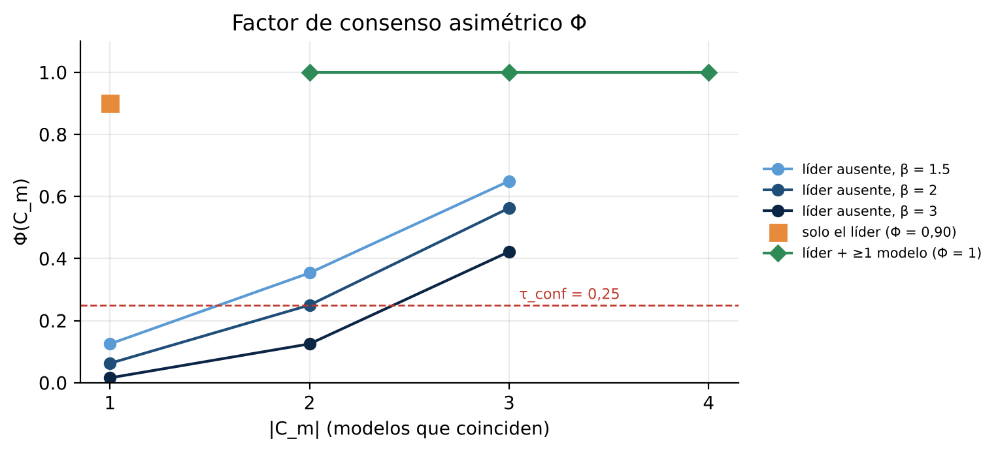{width=13cm}


Una detección fusionada se considera válida si \(\hat{s}_m \ge \tau_{conf}\). Los parámetros \(\gamma\), \(\Omega_{IoU}\), \(\beta\) y \(\tau_{conf}\) quedan como hiperparámetros del sistema de alertas.

### 6.5 Calibración del modelo de acoplamiento con los resultados reales

Tomando como métrica de calidad \(P_k\) el mAP@50 de TEST de cada modelo (Sección 5.6) y \(\gamma = 2\):

| Modelo | \(P_k\) (mAP@50 TEST) | \(P_k^2\) | \(w_k\) |
|---|---:|---:|---:|
| YOLOv8n | 0,825 | 0,6806 | 0,236 |
| YOLOv10n | 0,842 | 0,7090 | 0,246 |
| YOLO11n (líder \(L\)) | 0,872 | 0,7604 | **0,263** |
| RT-DETR-L | 0,859 | 0,7379 | 0,256 |
| **Suma** | | 2,8879 | 1,000 |


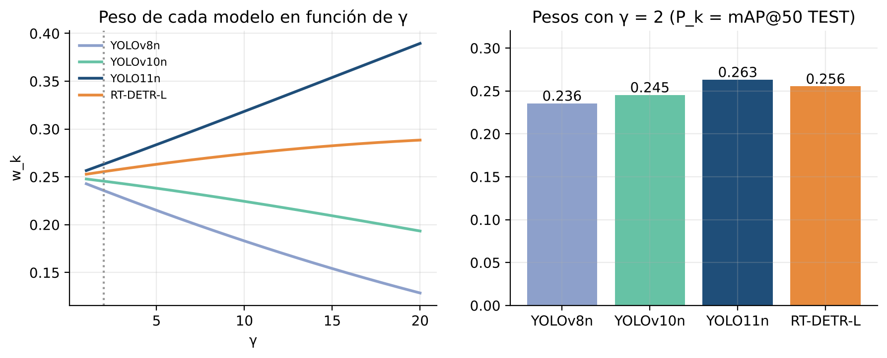{width=15cm}


**Ejemplo numérico (detección de un `Accidente`).** Supóngase que YOLO11n, RT-DETR-L y YOLOv8n detectan el mismo accidente con coordenada \(x_1\) igual a 150, 154 y 152 px y confianzas 0,94, 0,86 y 0,80, mientras YOLOv10n no lo detecta. Los productos \(w_k s_k\) son 0,2475, 0,2197 y 0,1885, de modo que:

\[
\hat{x}_1 = \frac{0{,}2475 \cdot 150 + 0{,}2197 \cdot 154 + 0{,}1885 \cdot 152}{0{,}2475 + 0{,}2197 + 0{,}1885} = \frac{99{,}63}{0{,}6558} = 151{,}92 \text{ px}.
\]

La confianza media ponderada es \(\bar{s} = 0{,}6558 / (0{,}263 + 0{,}256 + 0{,}236) = 0{,}869\); como el líder participa y \(|\mathcal{C}| = 3\), \(\Phi = 1\) y \(\hat{s} = 0{,}869 \ge \tau_{conf}\): la alerta se emite.

**Ejemplo numérico (falso positivo).** Si un reflejo induce solo a YOLOv10n a predecir `Fire` con \(s = 0{,}45\), entonces \(L \notin \mathcal{C}\), \(|\mathcal{C}| = 1\) y, con \(\beta = 2\), \(\Phi = (1/4)^2 = 0{,}0625\), por lo que \(\hat{s} = 0{,}028 < 0{,}25\) y la detección se descarta.

Con pesos tan cercanos entre sí (0,236–0,263), la fusión geométrica se comporta prácticamente como un promedio ponderado por confianza; la asimetría real del sistema la aporta \(\Phi\). Una extensión natural, coherente con la tabla por clase de la Sección 5.6, es usar pesos por clase \(w_{k,c} \propto (\mathrm{AP}_{k,c})^{\gamma}\), que darían mayor autoridad a RT-DETR-L en `Accidente` y `Fire` y a YOLO11n en `Bus`, `Carro` y `Moto`.

### 6.6 Coherencia entre modelo matemático e implementación

Las métricas de las Secciones 6.1–6.3 se calculan con la implementación de Ultralytics (`results.csv` y `model.val`), de modo que el modelo matemático de cada arquitectura coincide con el código ejecutado. El modelo de acoplamiento de las Secciones 6.4–6.5 está implementado en `app/app_modules/decision_engine.py` (función `fuse_detections`), que usa la aplicación y también el script de evaluación `scripts/evaluate_fusion_test.py`; así, los resultados de la sección 7.9 corresponden exactamente al código que se ejecuta en la aplicación. La sección 7.7 presenta la correspondencia componente por componente.

## Capítulo 7. Implementación de la aplicación y arquitectura del servicio

### 7.1 Estructura del repositorio

El repositorio sigue una organización orientada a separar datos, código, artefactos de entrenamiento, evaluaciones y documentación:

| Carpeta | Rol |
|---|---|
| `dataset/` | Imágenes y anotaciones del dataset SmartRoad AI. Es de **solo lectura**; no debe modificarse. |
| `scripts/` | Código Python para entrenamiento, evaluación, predicción y auditoría del dataset. |
| `models/base/` | Pesos preentrenados descargados (YOLOv8n, YOLOv10n, YOLO11n, RT-DETR-L). |
| `experiments/` | Carpeta de salida de cada entrenamiento: `args.yaml`, `results.csv`, curvas, pesos (`best.pt`, `last.pt`). |
| `evaluation/` | Resultados de `model.val(split="test")` y predicciones visuales sobre TEST e imágenes externas. |
| `external_data/` | Imágenes externas sin etiquetas, usadas para pruebas cualitativas de generalización. |
| `documentation/` | Informes, marco teórico, auditorías y evidencia escrita del proyecto. |
| `app/` | Aplicación web SmartRoad AI (Streamlit): interfaz, módulos de carga, inferencia, decisión, alertas y notificaciones. |

Todos los scripts calculan la ruta base del proyecto como `Path(__file__).resolve().parent.parent`, lo que permite ejecutarlos desde cualquier directorio de trabajo sin depender de la ubicación desde la que se invoquen.

### 7.2 Scripts de entrenamiento

Los cuatro modelos se entrenan mediante scripts independientes que siguen el mismo patrón:

1. Cargar el peso base con `YOLO(...)` (o `RTDETR(...)` para RT-DETR-L).
2. Definir rutas absolutas para el dataset, el proyecto y el nombre del experimento.
3. Invocar `model.train(...)` con los hiperparámetros elegidos.

| Script | Modelo | Peso base | Observaciones |
|---|---|---|---|
| `scripts/train_yolov8.py` | YOLOv8n | `models/base/yolov8n.pt` | Entrenamiento local; `data.yaml` apunta históricamente a otra máquina. |
| `scripts/train_yolov10.py` | YOLOv10n | `models/base/yolov10n.pt` | Entrenamiento local; genera un YAML temporal para el dataset. |
| `scripts/train_yolov11.py` | YOLO11n | `models/base/yolo11n.pt` | Diseñado para ejecutarse en Colab; reanuda desde Google Drive. |
| `scripts/train_rtdetr.py` | RT-DETR-L | `models/base/rtdetr-l.pt` | Entrenamiento local; usa `dataset/data.yaml` directamente. |

Cada script respeta la convención del proyecto de escribir los resultados en `experiments/<familia>/<nombre_experimento>/`, con `exist_ok=False` para evitar sobrescribir evidencia previa. La única excepción es YOLO11n, cuyo `args.yaml` indica `exist_ok: true` porque el entrenamiento se reanudó.

### 7.3 Scripts de evaluación y predicción

Además de los scripts de entrenamiento, el repositorio incluye utilidades para evaluar y visualizar el comportamiento de los modelos:

| Script | Función |
|---|---|
| `scripts/test_yolov8.py` | Ejecuta `model.val(split="test")` para YOLOv8n y guarda curvas/batch en `evaluation/yolov8/test_final/`. |
| `scripts/test_yolov10.py` | Evaluación TEST para YOLOv10n en `evaluation/yolov10/test_final/`. |
| `scripts/test_rtdetr.py` | Evaluación TEST para RT-DETR-L en `evaluation/rtdetr/test_final/`. |
| `scripts/predict_test_yolov8.py` | Genera predicciones visuales sobre el split TEST con YOLOv8n. |
| `scripts/predict_test_yolov10.py` | Genera predicciones visuales sobre el split TEST con YOLOv10n. |
| `scripts/predict_test_rtdetr.py` | Genera predicciones visuales sobre el split TEST con RT-DETR-L. |
| `scripts/predict_external_yolov8.py` | Ejecuta inferencia sobre `external_data/images/` con YOLOv8n. |
| `scripts/predict_external_yolov10.py` | Ejecuta inferencia sobre `external_data/images/` con YOLOv10n. |
| `scripts/predict_external_rtdetr.py` | Ejecuta inferencia sobre `external_data/images/` con RT-DETR-L. |
| `scripts/predict_fire_test_yolov8.py` | Predicciones dirigidas a la clase `Fire` sobre TEST con YOLOv8n. |
| `scripts/predict_fire_test_yolov10.py` | Predicciones dirigidas a la clase `Fire` sobre TEST con YOLOv10n. |
| `scripts/dataset_check.py` | Auditoría estructural del dataset (conteos, IDs, coordenadas, imágenes sin etiqueta). |
| `scripts/fix_polygon_labels.py` | Convierte anotaciones poligonales a cajas delimitadoras. |
| `scripts/delete_invalid_labels.py` | Identifica etiquetas vacías o con formato no reconocido. |

**Falta en la rama integrada:** no se encontraron `scripts/test_yolov11.py`, `scripts/predict_test_yolov11.py` ni `scripts/predict_external_yolov11.py`. Las métricas de TEST de YOLO11n provienen de un proceso de evaluación que no quedó registrado como script en el repositorio actual, lo que dificulta reproducirlas directamente.

### 7.4 Integración de los cuatro modelos

La integración de los cuatro detectores se realiza en la aplicación web `app/`. El módulo `model_manager.py` mantiene un registro con la ruta del `best.pt` de cada experimento definitivo, carga YOLOv8n, YOLOv10n y YOLO11n con la clase `YOLO` y RT-DETR-L con la clase `RTDETR`, y verifica que los nombres de clase del checkpoint coincidan exactamente con `Accidente`, `Bus`, `Camion`, `Carro`, `Fire` y `Moto`. Un modelo cuyo checkpoint falte o cuyas clases no coincidan se marca como no disponible y los demás siguen funcionando.

El módulo `inference.py` ejecuta los modelos disponibles de forma secuencial sobre la misma imagen, con el mismo umbral de confianza y tamaño de entrada, mide el tiempo de inferencia de cada uno y convierte la salida de Ultralytics en una lista estructurada de detecciones \((c, s, x_1, y_1, x_2, y_2)\). El módulo `decision_engine.py` toma esas cuatro listas y las consolida (Sección 7.7).

### 7.5 Servicio de inferencia y despliegue

La aplicación se ejecuta como servicio web local con Streamlit (`python -m streamlit run app/app.py` o el lanzador `app/run_demo.bat`, que verifica Python y las dependencias críticas) y se consulta desde el navegador en `http://localhost:8501`. Los modelos se cargan una sola vez por proceso gracias a `st.cache_resource` y, al cargarlos, se ejecuta una inferencia de calentamiento para que el tiempo reportado del primer modelo no incluya su inicialización. La imagen cargada se entrega a los modelos como arreglo en memoria, sin volver a comprimirla en un archivo temporal. La inferencia usa la GPU cuando está disponible (`device=0`) y pasa automáticamente a CPU si CUDA falla. Las dependencias propias de la aplicación están en `app/requirements.txt` (Streamlit, pandas, Plotly, Pillow, NumPy y OpenCV); PyTorch y Ultralytics se toman del entorno de entrenamiento.

No se implementa una API REST, contenedor Docker ni despliegue en la nube; el servicio está pensado para demostración local y para la sustentación del proyecto.

### 7.6 Aplicación SmartRoad AI

La aplicación se organiza en dos áreas: el **Laboratorio de modelos**, orientado a comparar técnicamente las predicciones de cada detector, y el **Centro de monitoreo**, que interpreta las predicciones consolidadas como lo haría un operador de una sala de control. La Figura 20 muestra la relación entre módulos.


{width=11cm}


El flujo de procesamiento de una imagen es: (1) el usuario carga la imagen y ajusta los parámetros en la barra lateral; (2) la aplicación ejecuta los cuatro modelos y almacena sus detecciones; (3) el laboratorio presenta los resultados individuales y comparativos; (4) el motor de decisión agrupa las detecciones, estima la carga vehicular y genera eventos candidatos de accidente o incendio; (5) el centro de monitoreo muestra la evidencia y permite revisar cada evento.

#### 7.6.1 Funcionalidades implementadas

| N.º | Funcionalidad | Área | Módulo principal |
|---:|---|---|---|
| 1 | Verificación automática de disponibilidad de los cuatro checkpoints y de la consistencia de sus clases | General | `model_manager.py` |
| 2 | Carga de imágenes JPG, JPEG y PNG con vista previa | General | `app.py` |
| 3 | Configuración de parámetros: umbral de confianza, tamaño de inferencia, IoU de agrupamiento, umbrales de carga vehicular y parámetros del modelo de fusión (γ, β, τ de alerta y τ de conteo) con vista de los pesos \(w_k\) | General | `app.py` |
| 4 | Inferencia multimodelo sobre la misma imagen con barra de progreso, uso de GPU y respaldo automático a CPU | Laboratorio | `inference.py` |
| 5 | Visualización de la imagen anotada por modelo, métricas de la inferencia, conteo por clase y descarga de la imagen anotada (PNG) | Laboratorio | `visualization.py` |
| 6 | Tabla comparativa automática (detecciones totales, conteo por clase, tiempo y dispositivo) | Laboratorio | `comparison.py` |
| 7 | Gráficos comparativos de detecciones por clase y de tiempo de inferencia por modelo | Laboratorio | `visualization.py` |
| 8 | Exportación a CSV del resumen por modelo y de las detecciones individuales | Laboratorio | `comparison.py` |
| 9 | Fusión ponderada multimodelo (Capítulo 6): agrupamiento por IoU, caja y confianza ponderadas, factor Φ y umbral τ; conteo de vehículos fusionados y estimación de la carga vehicular visual (baja, media, alta) | Monitoreo | `decision_engine.py`, `traffic_analysis.py` |
| 10 | Generación de alertas de posible accidente y posible incendio con confianza fusionada \(\hat{s} = \bar{s}\cdot\Phi\), prioridad, nivel de consenso, modelos que la respaldan e imagen de evidencia | Monitoreo | `decision_engine.py`, `visualization.py` |
| 11 | Gestión de eventos: confirmar o descartar, e historial de la sesión filtrable por tipo y estado, sin duplicar eventos al repetir un mismo análisis | Monitoreo | `alert_manager.py`, `app.py` |
| 12 | Notificaciones simuladas (modo DEMO) con registro, sin envío real de mensajes | Monitoreo | `notifications.py` |

Las Figuras 21 a 28 muestran la aplicación en funcionamiento con la imagen externa `Accidente 2.jpeg`.


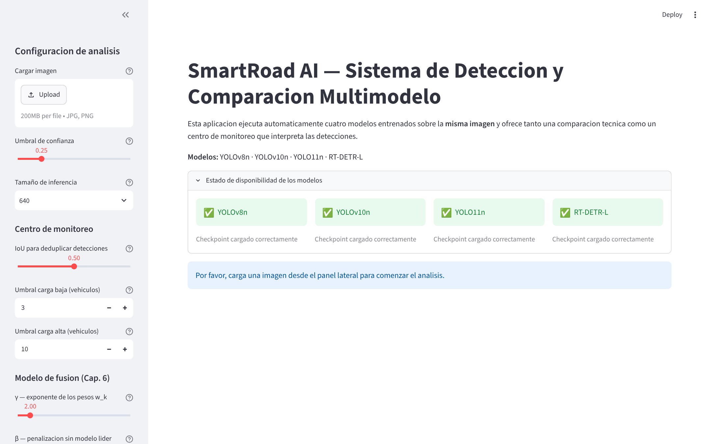{width=15cm}


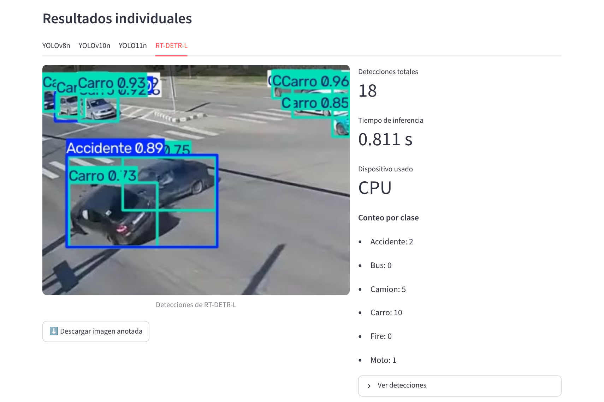{width=14cm}


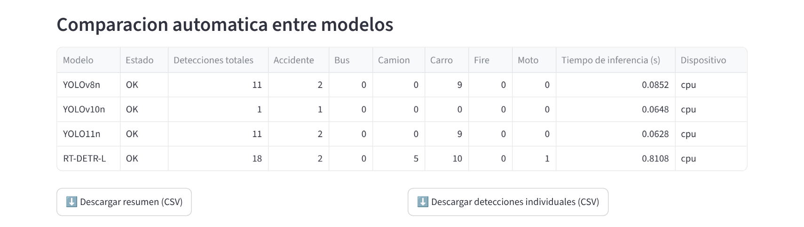{width=15cm}


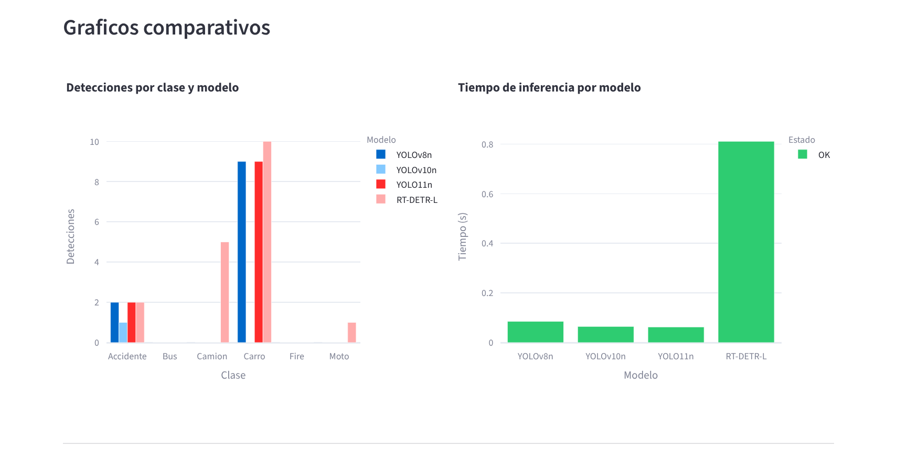{width=14cm}


{width=14cm}


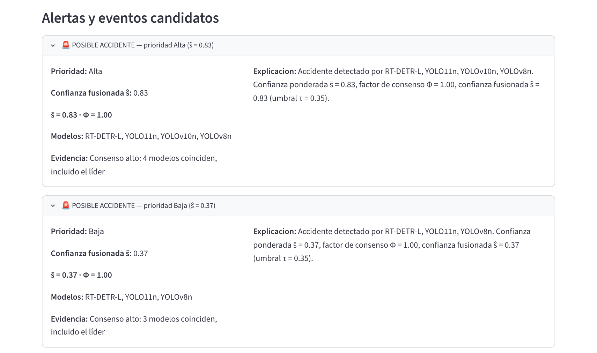{width=14cm}


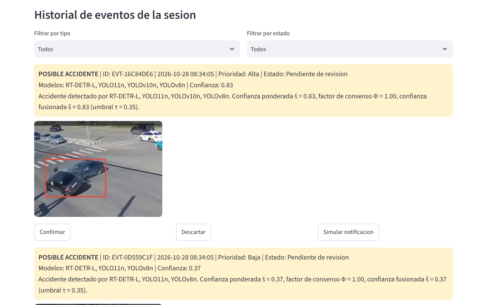{width=14cm}

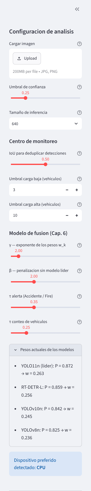{width=5cm}


### 7.7 Relación entre la aplicación y el modelo matemático

El motor de decisión implementa el modelo de acoplamiento de las Secciones 6.4 y 6.5. Para una imagen, recibe las detecciones \(\mathcal{D}_k\) de los modelos que se ejecutaron correctamente y aplica los siguientes pasos:

1. **Pesos.** \(w_k = P_k^{\gamma} / \sum_j P_j^{\gamma}\), con \(P_k\) el mAP@50 de TEST de la Sección 5.6 (constante `DEFAULT_MODEL_QUALITY`) y \(\gamma = 2\) por defecto. El modelo líder es \(L = \arg\max_k P_k\) (YOLO11n).
2. **Agrupamiento.** Para cada clase, las detecciones se recorren en orden descendente de \(w_k s_t\); cada una se une al grupo cuya caja fusionada tenga el mayor IoU \(\ge \Omega_{IoU}\) (0,5) y, si no hay ninguno, abre un grupo nuevo. La caja fusionada del grupo se recalcula tras cada incorporación.
3. **Fusión geométrica.** \(\hat{B}_m = \sum_t w_{k(t)} s_t B_t / \sum_t w_{k(t)} s_t\).
4. **Confianza ponderada.** \(\bar{s}_m = \sum_{k \in \mathcal{M}(\mathcal{C}_m)} w_k s_k^{\max} / \sum_{k \in \mathcal{M}(\mathcal{C}_m)} w_k\), donde \(s_k^{\max}\) es la confianza máxima del modelo \(k\) dentro del grupo. Usar el máximo por modelo evita que un modelo que emite dos cajas sobre el mismo objeto pese el doble.
5. **Consenso.** \(\Phi(\mathcal{C}_m)\) según la Sección 6.4, con \(\beta = 2\) y \(K\) igual al número de modelos ejecutados; \(\hat{s}_m = \bar{s}_m \cdot \Phi(\mathcal{C}_m)\).
6. **Activación.** Un grupo de `Accidente` o `Fire` genera alerta si \(\hat{s}_m \ge \tau_{alerta} = 0{,}35\), con prioridad Alta si \(\hat{s}_m \ge 0{,}60\), Media si \(\hat{s}_m \ge 0{,}45\) y Baja en otro caso. Un grupo de `Carro`, `Moto`, `Bus` o `Camion` se cuenta como vehículo si \(\hat{s}_m \ge \tau_{conteo} = 0{,}25\).

| Componente del modelo (Capítulo 6) | Implementación en `decision_engine.py` | Estado |
|---|---|---|
| Detecciones \(\mathcal{D}_k\) de cada modelo | `fuse_detections(per_model)` | Implementado |
| Pesos \(w_k = P_k^\gamma / \sum_j P_j^\gamma\) y líder \(L\) | `compute_model_weights`, `leader_model` | Implementado |
| Agrupamiento espacial por clase con \(\mathrm{IoU} \ge \Omega_{IoU}\) | `_cluster_class` | Implementado |
| Fusión geométrica ponderada \(\hat{B}_m\) | `Cluster.update_fusion` | Implementado |
| Confianza ponderada \(\bar{s}_m\) | `Cluster.update_fusion` (máximo por modelo) | Implementado |
| Factor de consenso \(\Phi(\mathcal{C}_m)\) | `consensus_factor` | Implementado |
| Umbral de activación \(\hat{s}_m \ge \tau\) | `_build_events` (alertas) y `build_decision_result` (conteo) | Implementado |

Los parámetros \(\gamma\), \(\beta\), \(\Omega_{IoU}\), \(\tau_{alerta}\) y \(\tau_{conteo}\) se ajustan desde la barra lateral (Figura 28), y la misma función `fuse_detections` se usa en la evaluación sobre TEST, de modo que lo que se mide es exactamente lo que ejecuta la aplicación.

### 7.8 Validación funcional de la aplicación

La aplicación se ejecutó con los cuatro checkpoints definitivos sobre cuatro imágenes externas, en CPU, con los parámetros por defecto (confianza 0,25, tamaño 640, \(\Omega_{IoU} = 0{,}5\), \(\gamma = \beta = 2\), \(\tau_{alerta} = 0{,}35\), \(\tau_{conteo} = 0{,}25\)). Los cuatro modelos cargaron correctamente y superaron la verificación de clases.

| Imagen | YOLOv8n | YOLOv10n | YOLO11n | RT-DETR-L | Vehículos (sin fusión → con fusión) | Eventos con fusión |
|---|---:|---:|---:|---:|---|---|
| Accidente 1 | 8 | 0 | 11 | 26 | 20 → 10 | 1 posible accidente, Media (ŝ = 0,54; RT-DETR-L + YOLO11n); 1 descartado (ŝ < τ) |
| Accidente 2 | 11 | 1 | 12 | 17 | 16 → 9 | 2 posibles accidentes: Alta (ŝ = 0,83; 4 modelos) y Baja (ŝ = 0,37; 3 modelos) |
| Fuego 2 | 2 | 2 | 2 | 2 | 0 → 0 | 2 posibles incendios, Alta (ŝ = 0,82 y 0,80; 4 modelos cada uno) |
| Mixto 1 | 38 | 42 | 56 | 135 | 107 → 55 | Ninguno |

Las columnas de modelos indican el número de detecciones de cada uno. La columna de vehículos compara el conteo por simple agrupamiento IoU (versión inicial del motor) con el conteo tras la fusión ponderada. Con el calentamiento inicial, en CPU los tres modelos YOLO tardaron entre 0,05 y 0,3 s por imagen y RT-DETR-L entre 0,75 y 0,95 s.

La fusión corrige los dos problemas que mostraba la versión inicial del motor. En `Accidente 2`, el grupo de vehículos estacionados marcado antes como posible accidente de prioridad Alta (confianza media 0,36) ahora conserva su alerta con prioridad Baja (ŝ = 0,37, apenas por encima de τ), mientras que el accidente real mantiene prioridad Alta (ŝ = 0,83); los 5 camiones que solo veía RT-DETR-L desaparecen del conteo. En `Mixto 1`, 52 de los 107 grupos de vehículos se descartan porque los respaldaba un solo modelo distinto del líder (\(\Phi = (1/4)^2 = 0{,}0625\)), y el conteo baja a 55, coherente con las 56 detecciones de YOLO11n.

### 7.9 Evaluación de la fusión sobre TEST y precisión de operación

Para medir el desempeño de la aplicación, el script `scripts/evaluate_fusion_test.py` ejecuta los cuatro modelos sobre las 2.313 imágenes presentes en `dataset/test/images` (12.819 objetos anotados: las 12.818 cajas de la Sección 3.4 más la instancia poligonal, convertida a su rectángulo envolvente), guarda sus predicciones y compara, con un mismo evaluador, cada modelo individual frente a la salida de `fuse_detections`, la función que usa la aplicación. Para los modelos individuales la puntuación de cada detección es su confianza; para la fusión es \(\hat{s}_m = \bar{s}_m \cdot \Phi(\mathcal{C}_m)\), calculada sobre las detecciones con confianza \(\ge 0{,}25\) (el umbral por defecto de la aplicación). Una predicción es acierto si su IoU con un objeto real de la misma clase es \(\ge 0{,}5\); el AP se calcula con interpolación de 101 puntos. Los resultados se guardan en `evaluation/fusion/test_final/`.

| Método | mAP@50 | P (umbral 0,25) | R (umbral 0,25) | F1 máx. (umbral) | Umbral con P ≥ 0,95 | R con P ≥ 0,95 |
|---|---:|---:|---:|---:|---:|---:|
| YOLOv8n | 0,797 | 0,806 | 0,777 | 0,791 (0,25) | 0,65 | 0,461 |
| YOLOv10n | 0,692 | 0,786 | 0,596 | 0,681 (0,30) | 0,70 | 0,319 |
| YOLO11n | 0,861 | 0,800 | 0,868 | 0,841 (0,35) | 0,70 | 0,532 |
| RT-DETR-L | 0,860 | 0,470 | 0,934 | 0,825 (0,55) | 0,85 | 0,336 |
| **Fusión (app)** | 0,885 | 0,821 | 0,867 | 0,854 (0,40) | 0,65 | 0,607 |

Las columnas «Umbral con P ≥ 0,95» y «R con P ≥ 0,95» indican el umbral de puntuación más bajo de la malla 0,05–0,95 con el que cada método alcanza una precisión mínima de 0,95, y el recall que conserva en ese punto. Los valores de este evaluador para YOLO11n (mAP@50 = 0,861) y RT-DETR-L (0,860) son consistentes con los de Ultralytics (0,872 y 0,859); la pequeña diferencia de YOLO11n se debe a que aquí solo se guardan detecciones con confianza \(\ge 0{,}05\).

**AP@50 por clase sobre TEST:**

| Clase | YOLOv8n | YOLOv10n | YOLO11n | RT-DETR-L | Fusión (app) |
|---|---:|---:|---:|---:|---:|
| Accidente | 0,901 | 0,922 | 0,945 | 0,958 | 0,965 |
| Bus | 0,815 | 0,638 | 0,882 | 0,895 | 0,904 |
| Camion | 0,767 | 0,613 | 0,832 | 0,827 | 0,863 |
| Carro | 0,853 | 0,498 | 0,895 | 0,892 | 0,907 |
| Fire | 0,565 | 0,581 | 0,691 | 0,726 | 0,745 |
| Moto | 0,883 | 0,900 | 0,922 | 0,862 | 0,927 |
| mAP@50 | 0,797 | 0,692 | 0,861 | 0,860 | 0,885 |


{width=16cm}


Tres resultados destacan:

1. **La fusión supera a todos los modelos individuales.** Alcanza un mAP@50 de 0,885 frente a 0,861 del mejor modelo (YOLO11n) y es la mejor en las seis clases, incluidas las dos críticas: `Accidente` (0,965) y `Fire` (0,745). Esto confirma empíricamente la hipótesis de la Sección 6.4: los modelos cometen errores distintos y su combinación ponderada los compensa.
2. **Precisión superior al 95 %.** Con el umbral de alerta por defecto (\(\tau = 0{,}35\)) la fusión prioriza la sensibilidad: para `Accidente` obtiene P = 0,914 y R = 0,920. Elevando el umbral a \(\hat{s} \ge 0{,}65\), la precisión global de la aplicación es **0,956** con un recall de 0,607; con una malla más fina, el umbral mínimo es 0,63 (P = 0,951, R = 0,636). En ese punto de operación la precisión por clase es 0,975 en `Accidente`, 0,965 en `Fire`, 0,978 en `Moto`, 0,947 en `Carro`, 0,932 en `Bus` y 0,927 en `Camion`. Para alcanzar la misma precisión, YOLO11n necesita un umbral de 0,67–0,70 y conserva solo un recall de 0,53–0,59, y RT-DETR-L baja a 0,34–0,45: la fusión conserva entre 5 y 27 puntos más de recall a igual precisión.
3. **El compromiso precisión–recall es explícito.** La aplicación permite operar en modo sensible (\(\tau_{alerta} = 0{,}35\), adecuado para no perder accidentes, con revisión humana en el centro de monitoreo) o en modo de alta precisión (\(\tau \ge 0{,}65\), precisión superior al 95 %, a costa de omitir detecciones de menor confianza, en especial de `Fire`, cuyo recall cae a 0,24).

**Robustez de los pesos.** Repetir la fusión excluyendo YOLOv10n (mAP@50 = 0,884) o recalculando \(w_k\) con las métricas de este evaluador (0,886) produce resultados prácticamente iguales, de modo que la mejora no depende de un ajuste fino de \(\gamma\) ni del aporte de un modelo concreto.

**Comportamiento de YOLOv10n.** Con el evaluador común, el checkpoint definitivo de YOLOv10n (`experiments/yolov10/entrenamiento_01_20_epochs/weights/best.pt`, confirmado por el equipo) obtiene un mAP@50 de 0,692 sobre el split TEST actual, por debajo del 0,842 que registra su curva PR en `evaluation/yolov10/test_final/`, con su menor desempeño en `Carro` (0,498), `Bus` (0,638) y `Camion` (0,613); la validación de Ultralytics sobre una muestra de 40 imágenes reproduce el mismo comportamiento. Se trata de una limitación propia de este modelo, entrenado 20 épocas con `batch=2`, en las clases vehiculares. La fusión es robusta a ella: el factor Φ y los pesos reducen el aporte de sus detecciones aisladas, y excluir el modelo o recalcular los pesos con estas métricas apenas cambia el resultado (mAP@50 de 0,884 y 0,886, respectivamente). Los pesos de la aplicación se mantienen con los valores de la Sección 5.6 para conservar la trazabilidad con la evaluación original de cada modelo.

### 7.10 Limitaciones de la aplicación

- Procesa imágenes individuales; no incluye video, seguimiento de objetos ni medición de flujo o velocidad, por lo que la carga vehicular es una estimación visual de una escena estática.
- Las notificaciones son simuladas y no se contacta a ningún servicio de emergencia.
- El historial de eventos y las notificaciones se conservan solo durante la sesión de Streamlit.
- La fusión agrupa por clase, de modo que un mismo vehículo clasificado como `Carro` por un modelo y como `Camion` por otro se cuenta dos veces.
- Los pesos \(w_k\) dependen del mAP@50 de TEST registrado para cada modelo; si un checkpoint cambia, `DEFAULT_MODEL_QUALITY` debe actualizarse.

## Capítulo 8. Conclusiones, limitaciones y trabajo futuro

### 8.1 Conclusiones generales

SmartRoad AI es un proyecto de detección de objetos orientado a la seguridad vial, con seis clases que combinan vehículos (`Bus`, `Camion`, `Carro`, `Moto`) y eventos de riesgo (`Accidente`, `Fire`). El dataset final contiene 39.546 imágenes de 640 × 640 píxeles (más de los 35.000 registros requeridos) y 176.927 anotaciones en formato YOLO de detección; todas las clases aparecen en al menos el 21 % de las imágenes y las clases de riesgo en el 65 %.

Se entrenaron cuatro arquitecturas representativas del estado del arte en detección en tiempo real: YOLOv8n, YOLOv10n, YOLO11n y RT-DETR-L. Los resultados de validación muestran un orden de desempeño claro, encabezado por YOLO11n (mAP@50 = 0,871; mAP@50-95 = 0,622), seguido de RT-DETR-L (0,855; 0,606), YOLOv10n (0,820; 0,540) y YOLOv8n (0,801; 0,545). Sobre TEST, YOLO11n alcanza mAP@50 = 0,8716 y mAP@50-95 = 0,6225, valores consistentes con su validación, y el evaluador común confirma el mismo orden entre modelos (sección 7.9).

Los cuatro modelos se integraron en una aplicación web local que los ejecuta sobre una misma imagen, compara sus resultados, consolida las detecciones por consenso espacial y presenta alertas de posible accidente o incendio en un centro de monitoreo con 12 funcionalidades. El motor de decisión implementa la fusión ponderada del modelo matemático (pesos por modelo, WBF, factor de consenso Φ y umbral τ), que en la validación funcional redujo falsas alarmas y sobreconteo de vehículos y cuyo desempeño sobre TEST se resume en la sección 7.9.

El análisis por clase sobre TEST revela que `Fire` es la clase más desafiante (mAP@50-95 = 0,3698), mientras que `Accidente` y `Bus` alcanzan los mejores resultados. Esto coincide con la hipótesis metodológica planteada en el Capítulo 3: las clases con formas irregulares o similares a fondos de alto contraste requieren atención específica en futuras iteraciones.

### 8.2 Limitaciones

El proyecto presenta limitaciones que deben tenerse en cuenta al interpretar los resultados:

1. **Falta de estandarización experimental.** Los cuatro modelos no fueron entrenados con el mismo batch size ni el mismo número de épocas; YOLO11n además se entrenó en Colab con `batch=16` y reanudación desde checkpoint.
2. **Versiones del dataset no verificables.** Los `args.yaml` apuntan a rutas distintas (máquina local de Omar, Colab, copia local), por lo que no es posible confirmar binariamente que todos usaron exactamente el mismo conjunto de imágenes y anotaciones.
3. **Métricas de TEST de distinta fuente.** El mAP@50-95 de TEST solo está disponible para YOLO11n; para los demás modelos se dispone de precisión, recall y mAP@50 calculados con el evaluador común.
4. **Etiquetas poligonales sin convertir.** Existen 11 anotaciones de `Accidente` en formato poligonal; al mezclarse con cajas en los mismos archivos, 58 cajas de entrenamiento (0,04 %) se cargaron distorsionadas.
5. **Imágenes sin etiqueta.** Cuatro imágenes de entrenamiento (0,01 %) carecen de etiqueta y se usaron como imágenes de fondo, aunque contienen objetos anotables.
6. **Reproducibilidad ambiental.** La aplicación declara sus dependencias en `app/requirements.txt`, pero el entorno de entrenamiento (versiones de PyTorch y CUDA) no está fijado en un archivo.
7. **Desempeño de YOLOv10n en clases vehiculares.** Sobre el split TEST actual, YOLOv10n obtiene un mAP@50 de 0,692, con su menor desempeño en `Carro`, `Bus` y `Camion` (sección 7.9).
8. **Despliegue local.** La aplicación funciona como servicio Streamlit local; no existe API, contenedor ni despliegue en producción.

### 8.3 Trabajo futuro

Para robustecer el proyecto y cerrar las brechas identificadas, se propone:

- **Persistir el mAP@50-95 de TEST** de YOLOv8n, YOLOv10n y RT-DETR-L con `scripts/test_*.py`.
- **Ejecutar un experimento controlado** en el que los cuatro modelos entrenen desde el mismo `data.yaml` y con hiperparámetros comparables (mismo batch, mismas épocas base, semilla común).
- **Depurar el dataset antes de reentrenar:** ejecutar `scripts/fix_polygon_labels.py`, anotar las cuatro imágenes sin etiqueta y agrupar las variantes aumentadas de una misma imagen en un solo split.
- **Reentrenar YOLOv10n** con más épocas y un batch mayor para mejorar sus clases vehiculares, y explorar pesos por clase \(w_{k,c}\) en la fusión.
- **Evolucionar la aplicación hacia producción**: API de inferencia (por ejemplo, FastAPI + ONNX/TensorRT), procesamiento de video con seguimiento de objetos, persistencia del historial de eventos y canales de notificación reales con autorización.
- **Documentar el entorno de entrenamiento** mediante un `environment.yml`, fijando las versiones de Ultralytics, PyTorch y CUDA.
- **Reforzar las clases críticas**, especialmente `Fire`, mediante técnicas de balanceo, aumentación específica o recolección de más ejemplos diversos.

---

## Capítulo 9. Referencias bibliográficas

[1] Fang, J., Qiao, J., Xue, J., & Li, Z. (2023). *Vision-Based Traffic Accident Detection and Anticipation: A Survey*. arXiv:2308.15985. https://arxiv.org/abs/2308.15985

[2] Razi, A., Chen, X., Li, H., Wang, H., & Russo, B. (2023). Deep learning serves traffic safety analysis: A forward-looking review. *IET Intelligent Transport Systems*, 17(4), 618–640. https://doi.org/10.1049/itr2.12257

[3] Zhao, R., Tang, S., Supeni, E. E., Rahim, S. B. A., & Fan, L. (2024). A Review of Object Detection in Traffic Scenes Based on Deep Learning. *Applied Mathematics and Nonlinear Sciences*, 9(1). https://doi.org/10.2478/amns-2024-0322

[4] Redmon, J., Divvala, S., Girshick, R., & Farhadi, A. (2016). You only look once: Unified, real-time object detection. *Proceedings of the IEEE Conference on Computer Vision and Pattern Recognition (CVPR)*, 779–788. https://doi.org/10.1109/CVPR.2016.91

[5] Jocher, G., Chaurasia, A., & Qiu, J. (2023). *Ultralytics YOLOv8* (Version 8.0.0) [Software]. https://github.com/ultralytics/ultralytics

[6] Wang, A., Chen, H., Liu, L., Chen, K., Lin, Z., Han, J., & Ding, G. (2024). YOLOv10: Real-Time End-to-End Object Detection. *Advances in Neural Information Processing Systems*, 37. arXiv:2405.14458. https://arxiv.org/abs/2405.14458

[7] Jocher, G., & Qiu, J. (2024). *Ultralytics YOLO11* [Software]. https://docs.ultralytics.com/models/yolo11

[8] Carion, N., Massa, F., Synnaeve, G., Usunier, N., Kirillov, A., & Zagoruyko, S. (2020). End-to-end object detection with transformers. *European Conference on Computer Vision (ECCV)*, 213–229. arXiv:2005.12872. https://doi.org/10.1007/978-3-030-58452-8_13

[9] Zhao, Y., Lv, W., Xu, S., Wei, J., Wang, G., Dang, Q., Liu, Y., & Chen, J. (2024). DETRs beat YOLOs on real-time object detection. *Proceedings of the IEEE/CVF Conference on Computer Vision and Pattern Recognition (CVPR)*, 16965–16974. arXiv:2304.08069. https://doi.org/10.1109/CVPR.2024.01603

[10] Solovyev, R., Wang, W., & Gabruseva, T. (2021). Weighted boxes fusion: Ensembling boxes from different object detection models. *Image and Vision Computing*, 107, 104117. https://doi.org/10.1016/j.imavis.2021.104117

---

## Capítulo 10. Anexos y evidencias complementarias

### Anexo A. Artefactos de entrenamiento

- `experiments/yolov8/yolov8n_20epochs-2/`
- `experiments/yolov10/entrenamiento_01_20_epochs/`
- `experiments/yolov11/entrenamiento_02_50_epochs_colab/`
- `experiments/rtdetr/entrenamiento_01_25_epochs/`

### Anexo B. Artefactos de evaluación

- `evaluation/yolov8/test_final/`
- `evaluation/yolov10/test_final/`
- `evaluation/yolov11/test_final/metrics_summary.txt`
- `evaluation/rtdetr/test_final/`
- `evaluation/fusion/test_final/` (modelos individuales y fusión de la app sobre TEST)

### Anexo C. Pruebas con imágenes externas

- `external_data/images/`
- `evaluation/*/external_test/results/`

### Anexo D. Scripts y configuraciones

- `scripts/train_*.py`
- `scripts/test_*.py`
- `scripts/predict_*.py`
- `dataset/data.yaml`
- `app/` (aplicación web, `app/README.md` con instrucciones de ejecución)
- `scripts/evaluate_fusion_test.py` (evaluación de la fusión sobre TEST)

### Anexo E. Aspectos de trazabilidad para la siguiente iteración

1. Persistir el mAP@50-95 de TEST de YOLOv8n, YOLOv10n y RT-DETR-L con `scripts/test_*.py`.
2. Versionar el notebook de evaluación de YOLO11n como script (`test_yolov11.py`, `predict_test_yolov11.py`, `predict_external_yolov11.py`).
3. Regenerar las pruebas externas de YOLOv8n y YOLOv10n sobre las 25 imágenes de `external_data/images/` con el checkpoint actual (el resumen de YOLOv8n apunta a una ruta anterior).
4. Unificar la ruta del dataset en los `args.yaml` de futuros entrenamientos (todos desde `dataset/data.yaml`).
5. Ejecutar `scripts/fix_polygon_labels.py` y anotar las cuatro imágenes de entrenamiento sin etiqueta.
6. Registrar por escrito los criterios de la actualización del dataset de octubre de 2026.
7. Añadir un `environment.yml` con las versiones del entorno de entrenamiento.

---

## Control de versiones del documento

| Versión | Fecha | Descripción | Autor |
|---|---|---|---|
| 0.2 | 2026-10-28 | Capítulos 1–8 redactados; correcciones de consistencia en el dataset y estados del arte/modelos/metodología/resultados. | Equipo SmartRoad AI |
| 0.3 | 2026-10-28 | Conversión a Word; figuras del dataset, resultados y modelo matemático; mAP@50 de TEST de los cuatro modelos; corrección de la decodificación anchor-free y de la pérdida de RT-DETR; calibración del acoplamiento con métricas reales. | Equipo SmartRoad AI |
| 0.4 | 2026-10-28 | Capítulo 7 reescrito con la aplicación SmartRoad AI (arquitectura, 12 funcionalidades, capturas, relación con el modelo matemático, validación funcional y precisión de operación); actualización de los Capítulos 1, 2, 6 y 8. | Equipo SmartRoad AI |
| 0.5 | 2026-10-28 | Fusión ponderada (pesos, WBF, Φ y τ) implementada en la aplicación y evaluada sobre TEST frente a los cuatro modelos; secciones 6.6 y 7.5–7.9 actualizadas; hallazgo sobre el checkpoint de YOLOv10n. | Equipo SmartRoad AI |
| 1.0 | 2026-10-28 | Versión final del Entregable 2: Capítulo 3 actualizado con el recuento final del dataset (39.546 imágenes); cierre de pendientes; descripción final de YOLOv10n. | Equipo SmartRoad AI |

---

