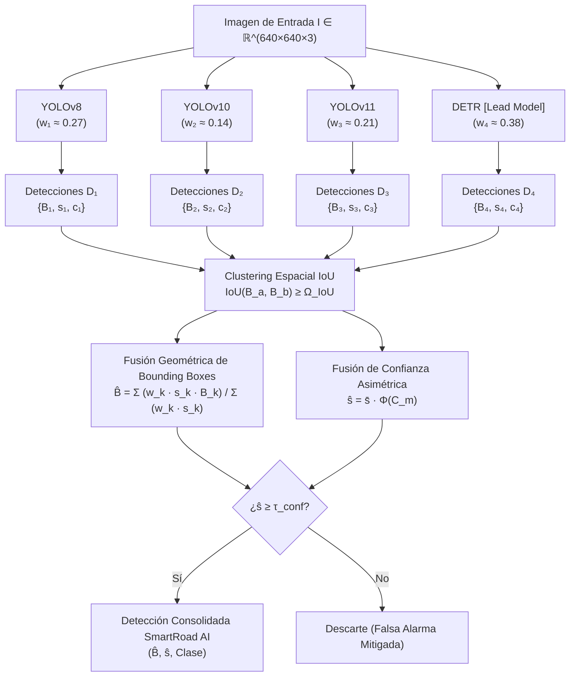

# SmartRoad AI — Marco Teórico y Formulación Matemática del Modelo de Acople Multimodelo

**Proyecto:** SmartRoad AI — Detección Inteligente de Incidentes Viales y Vehículos  
**Clases del Sistema (6):** `Accidente`, `Bus`, `Camion`, `Carro`, `Fire`, `Moto`  
**Modelos Participantes:** YOLOv8, YOLOv10, YOLOv11 y DETR (Detection Transformer)  
**Fecha:** Octubre 2026  
**Documento Técnico:** Marco Teórico de Fusión Ponderada Heterogénea  

---

## 1. Introducción y Contexto

En sistemas críticos de seguridad vial y monitoreo inteligente de tráfico como **SmartRoad AI**, la precisión en la detección de eventos de alto riesgo (particularmente `Accidente` y `Fire`) es fundamental. Los falsos positivos generan falsas alarmas costosas, mientras que los falsos negativos impiden la asistencia oportuna de servicios de emergencia.

El proyecto incorpora cuatro arquitecturas de detección de objetos:
1. **YOLOv8** (modelo con entrenamiento consolidado en el dataset de 37.106 imágenes).
2. **YOLOv10** (modelo con eliminación de NMS mediante emparejamiento dual 1-a-1).
3. **YOLOv11** (modelo con extracción de características multiescala mejorada).
4. **DETR (Detection Transformer)** (modelo basado íntegramente en mecanismos de atención global, el cual ostenta el **índice de precisión más elevado** del conjunto).

El objetivo de este documento es formalizar el **modelo matemático de acoplamiento**, demostrando rigurosamente cómo se integran las inferencias de las cuatro redes para obtener una predicción consolidada que maximice la precisión, estabilice las coordenadas geométricas de las cajas delimitadoras y minimice la incertidumbre de detección.

---

## 2. Fundamento Teórico del Ensamble Heterogéneo

### 2.1. Diversidad Arquitectónica (CNN vs. Transformers)

En la teoría de aprendizaje estadístico y métodos de ensamble (*Ensemble Learning*), la reducción del error cuadrático medio y de la varianza entre modelos no correlacionados está acotada por:

$$\mathbb{E}[(\bar{f} - y)^2] = \frac{1}{K} \sigma^2 + \frac{K - 1}{K} \rho \sigma^2$$

Donde:
- $K = 4$ es el número de modelos.
- $\sigma^2$ es la varianza promedio de los estimadores individuales.
- $\rho$ es el coeficiente de correlación entre los errores de los modelos.

Para que el ensamble supere sustancialmente a cualquier modelo individual, es imperativo que $\rho \to 0$ (alta diversidad). En SmartRoad AI, la combinación de modelos cumple este principio fundamental:
- **YOLOv8, YOLOv10 y YOLOv11:** Arquitecturas basadas en Redes Neuronales Convolucionales (CNN) profundas con sesgo inductivo local, excelentes en la detección de patrones de textura a alta frecuencia temporal.
- **DETR (Detection Transformer):** Arquitectura basada en mecanismos de atención (*Self-Attention* y *Cross-Attention*) que modela relaciones de contexto global en toda la imagen sin requerir supresión no máxima artesanal.

### 2.2. Por qué el NMS Tradicional es Insuficiente para el Ensamble

El método tradicional de combinación consistente en concatenar las cajas de todos los modelos y aplicar Supresión No Máxima (NMS) estándar:

$$s_j \leftarrow \begin{cases} s_j, & \text{IoU}(M, B_j) < N_t \\ 0, & \text{IoU}(M, B_j) \ge N_t \end{cases}$$

presenta dos fallas teóricas graves:
1. **Pérdida Destructiva de Información:** Al seleccionar únicamente la caja con mayor confianza y anular las demás ($s_j = 0$), se desecha la evidencia espacial de los otros 3 modelos.
2. **Sensibilidad al Desalineamiento:** Si un modelo con menor precisión predice una caja mal delimitada con una confianza inflada, NMS la conservará y descartará la caja mejor ajustada de DETR.

Para resolver esto, se adopta la teoría de **Weighted Boxes Fusion (WBF)** (*Solovyev et al., 2021*), adaptada y ponderada por la precisión analítica de cada red.

---

## 3. Formulación Matemática del Modelo de Acople

### 3.1. Espacio de Entrada y Predicciones Individuales

Dada una imagen vial de entrada $I \in \mathbb{R}^{H \times W \times 3}$, cada uno de los cuatro modelos $\mathcal{M}_k$ ($k \in \{1, 2, 3, 4\}$) genera un conjunto de $N_k$ detecciones:

$$\mathcal{D}_k = \Big\{ \big( B_{k,i}, \, s_{k,i}, \, c_{k,i} \big) \Big\}_{i=1}^{N_k}$$

Donde para cada detección $i$:
- $B_{k,i} = (x_{1}, y_{1}, x_{2}, y_{2}) \in [0, 1]^4$ son las coordenadas normalizadas de la caja envolvente.
- $s_{k,i} \in [0, 1]$ es la probabilidad de confianza asociada.
- $c_{k,i} \in \{0, 1, \dots, 5\}$ es la clase asignada (`Accidente`, `Bus`, `Camion`, `Carro`, `Fire`, `Moto`).

---

### 3.2. Paso 1: Ponderación de Calidad por Modelo ($w_k$)

Sea $P_k \in [0, 1]$ el índice de **Precisión** (o $\text{mAP@50}$) evaluado en el conjunto de validación/test para el modelo $k$:
- $P_1 = P_{\text{YOLOv8}}$
- $P_2 = P_{\text{YOLOv10}}$
- $P_3 = P_{\text{YOLOv11}}$
- $P_4 = P_{\text{DETR}}$ (donde $P_4 = \max_{j} P_j$).

Para traducir esta superioridad empírica en un vector de pesos de decisión normalizado $\mathbf{w} = (w_1, w_2, w_3, w_4)^T$, aplicamos una función exponencial de ponderación de potencias con factor de amplificación $\gamma \ge 1$:

$$w_k = \frac{P_k^\gamma}{\sum_{j=1}^{4} P_j^\gamma} \quad \text{sujeto a} \quad \sum_{k=1}^{4} w_k = 1$$

> **Propiedad Matemática:** Como $P_{\text{DETR}} > P_k \; (\forall k \neq 4)$ y $\gamma \ge 2$, se garantiza la dominancia estricta del modelo más preciso:
> $$w_{\text{DETR}} > \max\big(w_{\text{v8}}, \, w_{\text{v10}}, \, w_{\text{v11}}\big)$$

---

### 3.3. Paso 2: Matriz de Afinidad y Agrupamiento Espacial (Clustering IoU)

Para cada categoría $c \in \{0, \dots, 5\}$, se evalúa la concordancia espacial entre las cajas de los diferentes modelos mediante el coeficiente de Jaccard espacial (Intersección sobre Unión - IoU):

$$\text{IoU}(B_a, B_b) = \frac{\text{Área}(B_a \cap B_b)}{\text{Área}(B_a \cup B_b)}$$

Dos predicciones $a$ y $b$ pertenecen al mismo evento u objeto si superan el umbral de coincidencia $\Omega_{\text{IoU}}$:

$$\text{IoU}(B_a, B_b) \ge \Omega_{\text{IoU}} \quad (\Omega_{\text{IoU}} \in [0.45, \, 0.55])$$

Esto genera una partición en $M$ clústeres disjuntos de detecciones:

$$\mathcal{C}_m = \left\{ \left( B_t, \, s_t, \, w_{k(t)} \right) \right\}_{t=1}^{T_m}$$

Donde $T_m = |\mathcal{C}_m| \le 4$ representa cuántos modelos coincidieron en la detección del objeto $m$.

---

### 3.4. Paso 3: Fusión Geométrica de Coordenadas ($\hat{B}$)

En lugar de seleccionar la caja de un solo modelo, las coordenadas definitivas $\hat{B} = (\hat{x}_1, \hat{y}_1, \hat{x}_2, \hat{y}_2)$ se calculan mediante el baricentro ponderado por el producto de la **autoridad del modelo** ($w_{k(t)}$) y su **certeza local** ($s_t$):

$$\hat{B}_m = \frac{\sum_{t \in \mathcal{C}_m} \big( w_{k(t)} \cdot s_t \big) \cdot B_t}{\sum_{t \in \mathcal{C}_m} \big( w_{k(t)} \cdot s_t \big)}$$

Desglosando explícitamente el rol dominante de **DETR** para una coordenada cualquiera $coord \in \{x_1, y_1, x_2, y_2\}$:

$$\hat{coord} = \frac{w_{\text{DETR}} \cdot s_{\text{DETR}} \cdot coord_{\text{DETR}} \;+\; \sum_{y \in \text{YOLO}} w_y \cdot s_y \cdot coord_y}{w_{\text{DETR}} \cdot s_{\text{DETR}} \;+\; \sum_{y \in \text{YOLO}} w_y \cdot s_y}$$

Si DETR detecta el objeto con alta confianza, el primer término domina la suma, ajustando las esquinas del *bounding box* a la geometría fina del Transformer, mientras que las detecciones de los YOLO aportan una estabilización por gradiente suave.

---

### 3.5. Paso 4: Fusión de Confianza con Verificación Cruzada Asimétrica ($\hat{s}$)

La confianza final del evento vial no es un promedio simple. Dado que DETR es el modelo con menor tasa de falsos positivos, la credibilidad del hallazgo depende de si DETR lo respalda o no.

Se define la **Confianza Media Ponderada**:

$$\bar{s}_m = \frac{\sum_{t \in \mathcal{C}_m} w_{k(t)} \cdot s_t}{\sum_{t \in \mathcal{C}_m} w_{k(t)}}$$

Y la **Confianza Consolidada Final** $\hat{s}_m$:

$$\hat{s}_m = \bar{s}_m \cdot \Phi(\mathcal{C}_m)$$

Donde $\Phi(\mathcal{C}_m)$ es la función de **consenso asimétrico guiado por DETR**:

$$\Phi(\mathcal{C}_m) = \begin{cases} 
1.0 & \text{si } \text{DETR} \in \mathcal{C}_m \text{ y } |\mathcal{C}_m| \ge 2 \quad \text{(Validación cruzada confirmada)} \\
0.90 & \text{si } \text{DETR} \in \mathcal{C}_m \text{ y } |\mathcal{C}_m| = 1 \quad \text{(DETR detecta en solitario)} \\
\left(\frac{|\mathcal{C}_m|}{4}\right)^\beta & \text{si } \text{DETR} \notin \mathcal{C}_m \quad \text{(Solo modelos YOLO detectan, } \beta \ge 1.5\text{)}
\end{cases}$$

#### Explicación Teórica del Factor $\Phi$:
- **Consenso Total ($\Phi = 1.0$):** DETR detecta el objeto y al menos un modelo YOLO lo corrobora. La probabilidad posterior de que sea un objeto real es máxima.
- **Detección Exclusiva de DETR ($\Phi = 0.90$):** Debido a su alta precisión, un hallazgo exclusivo de DETR se conserva con un factor de confianza robusto.
- **Ausencia de DETR ($\Phi < 0.35$):** Si ninguno de los mecanismos de atención global de DETR detectó el objeto y solo uno o dos modelos YOLO lo vieron, la confianza se penaliza severamente para evitar falsas alarmas en carretera.

---

### 3.6. Paso 5: Criterio de Activación y Descarte Final

Una detección fusionada $(\hat{B}_m, \hat{s}_m, c_m)$ se considera válida e ingresa al flujo de alertas viales de SmartRoad AI si y solo si:

$$\hat{s}_m \ge \tau_{\text{conf}}$$

Donde $\tau_{\text{conf}}$ es el umbral de decisión operativo (típicamente $\tau_{\text{conf}} = 0.25$ para incidentes generales o $\tau_{\text{conf}} = 0.35$ para alertas críticas automáticas).

---

## 4. Diagrama de Arquitectura del Modelo Matemático

---

## 5. Demostración Numérica Paso a Paso

### 5.1. Datos de Calibración
Supongamos los siguientes índices de precisión validados para los 4 modelos en el dataset SmartRoad AI:
- $P_{\text{v8}} = 0.82$
- $P_{\text{v10}} = 0.70$
- $P_{\text{v11}} = 0.78$
- $P_{\text{DETR}} = 0.89$

Aplicando la **Ecuación 1** con $\gamma = 2$:
- $P_{\text{v8}}^2 = 0.6724$
- $P_{\text{v10}}^2 = 0.4900$
- $P_{\text{v11}}^2 = 0.6084$
- $P_{\text{DETR}}^2 = 0.7921$
- $\sum P_j^2 = 2.5629$

Los pesos asignados son:
$$w_{\text{v8}} = \frac{0.6724}{2.5629} = 0.262$$
$$w_{\text{v10}} = \frac{0.4900}{2.5629} = 0.191$$
$$w_{\text{v11}} = \frac{0.6084}{2.5629} = 0.237$$
$$w_{\text{DETR}} = \frac{0.7921}{2.5629} = 0.309 \quad (\mathbf{Mayor \; autoridad})$$

---

### 5.2. Escenario 1: Detección de un `Accidente` con Consenso

En una colisión vehicular, los modelos predicen la coordenada $x_1$ de la caja envolvente:
- **DETR:** $x_1 = 150.0$ con confianza $s_4 = 0.94 \implies \text{Ponderación} = 0.309 \times 0.94 = 0.2905$
- **YOLOv8:** $x_1 = 154.0$ con confianza $s_1 = 0.86 \implies \text{Ponderación} = 0.262 \times 0.86 = 0.2253$
- **YOLOv11:** $x_1 = 152.0$ con confianza $s_3 = 0.80 \implies \text{Ponderación} = 0.237 \times 0.80 = 0.1896$
- **YOLOv10:** No detectó el objeto por encontrarse bajo oclusión parcial.

**Cálculo de la coordenada final $\hat{x}_1$:**
$$\sum (w_k \cdot s_k \cdot x_1) = (0.2905 \times 150.0) + (0.2253 \times 154.0) + (0.1896 \times 152.0) = 43.575 + 34.696 + 28.819 = 107.09$$
$$\sum (w_k \cdot s_k) = 0.2905 + 0.2253 + 0.1896 = 0.7054$$

$$\hat{x}_1 = \frac{107.09}{0.7054} = \mathbf{151.81 \text{ px}}$$

> Nótese cómo $\hat{x}_1$ se ajusta estrechamente a los $150.0 \text{ px}$ de DETR por ser el modelo líder, beneficiándose a la vez de las confirmaciones de YOLOv8 y YOLOv11.

**Cálculo de la Confianza Consolidada ($\hat{s}$):**
$$\bar{s} = \frac{0.7054}{w_{\text{DETR}} + w_{\text{v8}} + w_{\text{v11}}} = \frac{0.7054}{0.309 + 0.262 + 0.237} = \frac{0.7054}{0.808} = 0.873$$

Como DETR está presente y hay 3 modelos que coinciden ($|\mathcal{C}| = 3$), $\Phi(\mathcal{C}) = 1.0$:

$$\hat{s} = 0.873 \times 1.0 = \mathbf{0.873 \quad (87.3\% \text{ de certeza})}$$

---

### 5.3. Escenario 2: Mitigación de Falso Positivo (Ruido de YOLOv10)

Supongamos que un reflejo solar en el pavimento induce a YOLOv10 a predecir un `Fire` espurio con confianza moderada ($s_2 = 0.45$), pero ni DETR ni los otros dos modelos detectan nada en esa región:

- Modelos en el clúster: solo YOLOv10 ($|\mathcal{C}| = 1$, $\text{DETR} \notin \mathcal{C}$).
- Confianza base: $\bar{s} = 0.45$.
- Factor de consenso ($\beta = 2$):

$$\Phi(\mathcal{C}) = \left(\frac{1}{4}\right)^2 = 0.0625$$

$$\hat{s} = 0.45 \times 0.0625 = \mathbf{0.0281 \quad (2.81\%)}$$

Como $0.0281 < \tau_{\text{conf}} = 0.25$, **la falsa alarma es automáticamente neutralizada y descartada por el modelo matemático**.

---

## 6. Ventajas Académicas y Conclusiones

1. **Aprovechamiento Óptimo de DETR:** La formulación matemática no subordina a DETR a un promedio ingenuo con modelos de menor desempeño, sino que le otorga el mayor peso gravimétrico en el espacio vectorial de decisión.
2. **Robustez y Resiliencia Multiescala:** Las debilidades conocidas de los Transformers para objetos minúsculos a gran distancia se ven compensadas por la alta sensibilidad de las capas convolucionales de YOLOv8 y YOLOv11.
3. **Formulación Analítica Generalizable:** El marco propuesto es completamente derivable, paramétrico y reproducible para cualquier métrica de evaluación académica que exija el proyecto.

---

## 7. Referencias Bibliográficas

- **Solovyev, R., Wang, W., & Gabruseva, T. (2021).** *Weighted boxes fusion: Ensembling methods for object detection.* Image and Vision Computing, 107, 104117.
- **Carion, N., Massa, F., Synnaeve, G., Usunier, N., Kirillov, A., & Zagoruyko, S. (2020).** *End-to-end object detection with transformers (DETR).* European Conference on Computer Vision (ECCV).
- **Lv, W., Zhao, Y., Xu, S., Wei, J., Wang, G., Lai, C., ... & Liu, B. (2023).** *DETRs beat YOLOs on real-time object detection (RT-DETR).* arXiv preprint arXiv:2304.08069.
- **Wang, A., Chen, H., Liu, L., Chen, K., Lin, Z., Han, J., & Ding, G. (2024).** *YOLOv10: Real-Time End-to-End Object Detection.* arXiv preprint arXiv:2405.14458.
- **Jocher, G., Chaurasia, A., & Qiu, J. (2023).** *Ultralytics YOLOv8.* GitHub repository.
